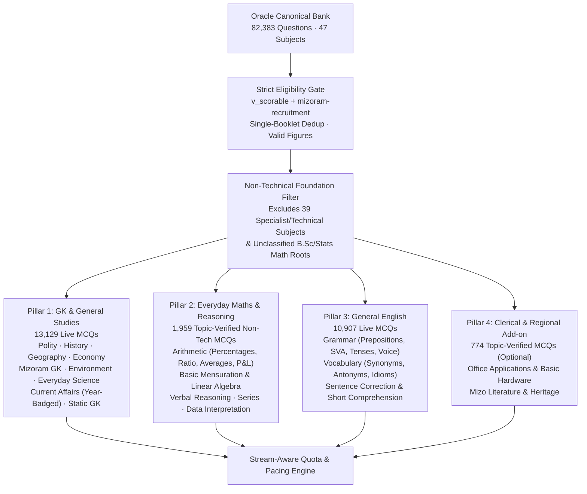
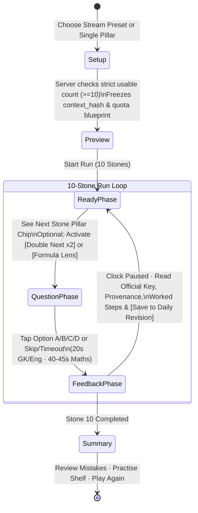
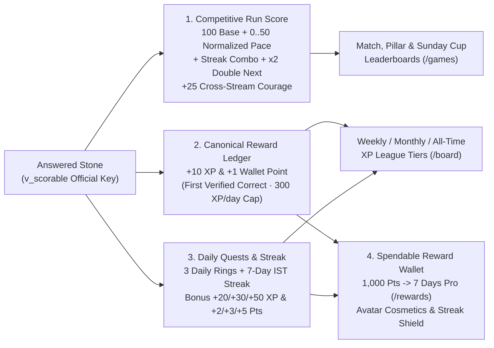

# Core Foundation Learning Game — Design & Architecture

8 November 2026 · Planning and interactive prototype specification for `study.hawayu.in` (Web `1240px` & Mobile `390×844`).  
No live canonical bank records, official keys, or applied migrations were modified to produce this design.

---

## 1. Product Problem & Core Thesis

Learners on **India Study Map** come from widely different academic branches and streams — **Arts & Humanities (BA)**, **Science (BSc)**, **Engineering & Technical (BTech / Diploma)**, **Commerce & Accounts (BCom / JAO)**, **Medical & Nursing**, **Agriculture**, and **Law** — yet every candidate sitting for MPSC examinations (MCS Combined Prelims, UDC, Assistant Grade, LDC, Group B Gazetted, and Group B Non-Gazetted) must pass the **Shared Foundation Papers**:

1. **General Knowledge & General Studies (GK/GS)** — Indian Polity, Indian History, Geography, Indian Economy, Environment, Everyday General Science, Current Affairs, and Mizoram Society/History/Culture.
2. **General English** — Grammar, Vocabulary (Synonyms, Antonyms), Idioms & Phrases, and Sentence Correction.
3. **Everyday Maths & Reasoning (Non-Technical)** — Simple Arithmetic (Percentages, Ratio & Proportion, Averages, Profit & Loss, HCF/LCM, Interest, Time & Work), Basic Mensuration, and Verbal/Series/Data Reasoning.

### Why a Naive "Whole-Bank" Game Fails Multi-Stream Learners

An audit of the live Oracle inventory (`82,383` canonical questions across `1,979` papers and `47` taxonomy subjects) exposes three structural friction points when games draw too broadly:

| Problem | Live Bank Evidence (`2026-11-07` inventory) | Impact on Multi-Stream Learners |
| :--- | :--- | :--- |
| **1. Specialist & Technical Contamination** | Over `35,000` live MCQs belong to specialist branch papers (`civil-engineering` 4,943, `law` 4,713, `medicine` 3,689, `mechanical-engineering` 3,601, `electrical-engineering` 3,432, `service-rules` 3,315, `agriculture` 2,123). Even inside `mathematics` (`2,165` live MCQs), specialist papers like *Inspector of Statistics 2026 Paper-III* contain undergraduate Calculus, PDEs/ODEs, and Operations Research. | A general or Arts learner choosing "Mixed" or "Mathematics" gets hit with B.Sc Calculus or Engineering Circuits, causing immediate abandonment. |
| **2. Uniform Timer Punishes Non-Math Streams** | Existing game modes apply one uniform round clock (`15s` Speed, `20s` Duel/Trail, `25s` Gauntlet) regardless of task type. | Reading and recalling a Mizoram station code (`cq_326831cc99b74d79`) takes `8–12s`, whereas solving a weighted-average or ratio word problem (`cq_24abda43a80123f4`) takes `30–45s`. Arts/Humanities learners are penalized by speed timers on Arithmetic and resort to random guessing. |
| **3. Asymmetric Strengths Across Streams** | Science/Engineering graduates are comfortable with Arithmetic & Reasoning but often lack systematic recall in **Indian Polity, Modern History, Mizo Literature/Culture, and English Idioms**. Arts graduates have the reverse profile. | One-size-fits-all mixed draws either bore learners in their strong subjects or overwhelm them in their weak pillars without teaching the underlying concept. |

---

## 2. The Curated Non-Technical Foundation Pool (`v_foundation_game_pool`)

The learning game operates strictly over a **Curated Non-Technical Foundation Pool** of **`26,995` live MCQs** (filtered at draw time through `v_scorable` for `official`/`key` provenance, `2–6` distinct non-empty options, single primary booklet deduplication per `study-tagging-v1` §9, and valid rendered diagrams where `has_diagram = true`).



### Exact Taxonomy Whitelist for the Foundation Game

| Foundation Pillar | Included Active `review_taxonomy` Paths | Live MCQs | Explicit Exclusions (Guardrails) |
| :--- | :--- | ---: | :--- |
| **1. GK & General Studies** | `general-studies/*` (`current-affairs` 2,749, `indian-history` 1,371, `indian-economy` 1,199, `indian-polity` 1,080, `geography` 1,045, `mizoram` 896, `environment` 477, `world-history` 16)<br>`general-knowledge/*` (`static-gk` 448, `sports` 270, `art-and-culture` 251, `science-in-the-news` 139)<br>`science/biology*` (494), `science/physics*` (525), `science/chemistry*` (180) | **13,129** | Excludes specialist `biochemistry`, `microbiology`, `geology`, `forestry`, `agriculture`, `medicine`, `nursing`, `public-health`. |
| **2. Everyday Maths & Reasoning** | `mathematics/arithmetic*` (`840`: `percentages` 102, `ratio-and-proportion` 73, `profit-and-loss` 24, `averages` 19, general arithmetic)<br>`mathematics/mensuration*` (`116`: `area` 44, `volume` 42)<br>`mathematics/geometry*` (`62`: `triangles` 19, `circles` 13, `lines-and-angles` 6)<br>`mathematics/algebra/*` (`105`: `algebraic-expressions` 51, `linear-equations` 43, `quadratic-equations` 11)<br>`reasoning-and-aptitude/*` (`1,099`: `verbal-reasoning` 871, `series` 128, `data-interpretation` 71, `numerical-ability` 29) | **2,222** *(topic-verified)* | **Critical Guardrail:** Excludes bare subject-only `mathematics` (`topic_id IS NULL`) and `statistics/*` unless paper is in `('udc','ldc','assistant','combined-prelims','group-b-non-gazetted')`. This blocks B.Sc/M.Sc Calculus, Real Analysis, and Operations Research from *Inspector of Statistics Paper-III*. |
| **3. General English** | `english/grammar*` (`4,157`: `parts-of-speech` 288, `prepositions` 190, `tenses` 137, `subject-verb-agreement` 64, `voice` 41, `articles` 8, `reported-speech` 3)<br>`english/vocabulary*` (`1,849`: `idioms-and-phrases` 316, `one-word-substitution` 154, `synonyms` 83, `antonyms` 32)<br>`english/sentence-correction` (`161`) | **6,167** *(topic-verified)* | Excludes `english/writing/*` (written essay/précis/letter tasks) and long multi-screen passages (`length(passage) > 650`) in timed game modes. |
| **4. Clerical & Regional (Optional)** | `computer-science/office-applications` (174), `computer-science/computer-systems-and-architecture/*` (`computer-hardware` 63, `memory-and-storage` 52, `data-processing` 29, `history-and-generations` 26)<br>`mizo/literature` (232) | **576** *(topic-verified)* | Excludes specialist `computer-science/programming`, `data-structures`, `databases`, `operating-systems`, `networking`. |

---

## 3. Adapting to Learner Streams Without Creating Silos

Instead of forcing users into rigid branch silos, the game asks one plain-language question in setup: **"What is your background or focus today?"** (saved in `game_preferences.selection` and changeable before any run).

### 3.1 Four Stream-Aware Blueprint Presets (10-Question Run)

| Stream / Background Preset | Who It Serves | 10-Question Quota Blueprint | Task-Aware Pacing & Scaffolding |
| :--- | :--- | :--- | :--- |
| **1. Humanities / Arts Comfort**<br>*(Gentle Maths · Strong GS & English)* | BA / Social Science / Literature / Law learners who want core exam practice without math panic. | • **5 GK & General Studies**<br>• **3 General English**<br>• **2 Everyday Arithmetic / Reasoning** | • GK/English clock: `20s`<br>• **Maths/Reasoning clock: `45s`**<br>• Automatic **Formula & Step Hint** card unlocked on the 2 Maths stones. |
| **2. Science & Tech Bridge**<br>*(Sharpen GK, Polity, History & Mizoram)* | BSc / BTech / BCA / Commerce / Medical learners who are fast at numbers but need humanities & state GK retention. | • **6 GK & General Studies** *(weighted to Polity, History, Geography, Mizoram, Economy)*<br>• **2 General English** *(Idioms & Prepositions)*<br>• **2 Everyday Maths & Reasoning** | • GK/English clock: `20s`<br>• Maths/Reasoning clock: `35s`<br>• Post-question feedback highlights **Constitutional Articles, Historical Chronology, and Mizoram Context**. |
| **3. Balanced MPSC Core**<br>*(Standard Prelims / UDC / Group B Mix)* | Any aspirant wanting a proportional mini-blueprint of MPSC Paper I & II common sections. | • **4 GK & General Studies**<br>• **3 General English**<br>• **3 Everyday Maths & Reasoning** | • GK/English clock: `20s`<br>• Maths/Reasoning clock: `40s`<br>• Mirrors the exact cross-disciplinary balance of UDC / Assistant / Group B Non-Gazetted exams. |
| **4. Single-Pillar Focus**<br>*(Pick 1 Pillar or Shelf)* | Learners targeting a single weak area today. | • **10 questions** from one chosen pillar:<br>  – *Only GK & General Studies* (or a shelf: Polity, History, Geography, Mizoram, Current Affairs, Everyday Science)<br>  – *Only Everyday Maths & Reasoning*<br>  – *Only General English* | • Uses the pillar's native clock (`20s` for GK/English, `45s` for Everyday Maths & Reasoning). |

---

## 4. Core Game Loop: "Foundation Circuit" (Learn-As-You-Play)

Existing `/games` modes (Gauntlet, Speed, Duel, Cup) test raw recall under continuous timers, while `/trail` (Topic Trail) covers single narrow 10-question packs. **Foundation Circuit** upgrades the learning game experience across both solo and shared play by introducing **Task-Aware Clocks**, **Paused Worked Feedback**, **Formula Scratchpads**, and **Strategic Run Tokens**.



### 4.1 Five Learning-First & Competitive Mechanics

1. **No Early Elimination + Task-Normalized Competitive Scoring**:
   - Every run is **10 distinct official-key questions** (`stones 1..10`).
   - Unlike Gauntlet (where 3 wrong answers end the run), a wrong answer on Stone 3 never kicks the learner out of the session — it marks Stone 3 as **`Revise`** (`#B0412A` border / `#F5E1D8` fill) and opens the worked explanation immediately while the clock pauses.
   - To make the game **highly competitive** while remaining 100% fair between `20s` GK/English stones and `40–45s` Everyday Maths stones, scoring uses a **Task-Normalized Pace Bonus** (`0–50 pts`) on top of **`100` Base Accuracy Points**, plus **Streak Combo Bonuses** (`+15` to `+50 pts`) and **Cross-Stream Courage Bonuses** (`+25 pts`). See **Section 6** for the full formula.

2. **Pre-Stone Pillar Preview & Strategic Tokens (Between Questions)**:
   - Before revealing Stone $k$, the paused bridge shows the upcoming question's **Pillar & Topic Chip** (e.g., `Stone 4 of 10 · Everyday Maths · Percentages` or `Stone 5 of 10 · General Studies · Indian Polity`).
   - The learner holds **two single-use learning tokens per run** (validated server-side before question reveal):
     - **`Double Next (×2)`**: Stake on a stone in your strong pillar (or challenge yourself!) to double the stone's Base + Pace points (`(100 + PaceBonus) × 2`, up to **`300` pts** before streak bonuses).
     - **`Formula / Concept Lens (💡)`**: Available on Everyday Maths, Reasoning, or Grammar stones. Reveals the core rule/formula (e.g., *"HCF × LCM = Product of the two numbers"* or *"Compound subject expressing a single idea takes a singular verb"*) **without** giving away the answer or reducing Base Accuracy points.

3. **Built-in Quick Scratchpad & Step Breakdown for Everyday Maths**:
   - When a question is from `mathematics/*` or `reasoning-and-aptitude/*`, the UI automatically surfaces a **Quick Scratchpad / Number Jotter** (a lightweight 3-line calculation memo pad + common fraction/percentage reference strip) so mobile and desktop users can jot intermediate numbers (`72 + 8 = 80 = 40% → Total = 200`) right inside the card.

4. **Temporal Honesty for Current Affairs (`study-tagging-v1` §4)**:
   - Every Current Affairs question (`general-studies/current-affairs` or `general-knowledge/science-in-the-news`) displays a prominent **Reference Period Badge** in the card header (e.g., `Asked in 2026 · Reference: Jan 2026` or `Asked in 2017 · Reference: 2017 NIRF`) and preserves its original official key, with a one-line reminder: *"Scored against the official key of the original examination year."*

5. **Direct Bridge to Daily Revision (`/revision`)**:
   - In the paused feedback panel and final summary, any missed or tricky question has a one-tap **`+ Save for tomorrow's revision`** button that bookmarks the canonical ID into the user's Study Desk so `/revision` automatically schedules it the next day.

---

## 5. Fair Cross-Stream Multiplayer ("Common Core Duel & Desk Party")

When two friends from different branches (for example, a **Civil Engineer** and a **BA English graduate**) join a 1v1 Duel or a 2–4 player Study Desk Room:

1. **Guaranteed Level Playing Field**:
   - Duels use the **Balanced Common Core Blueprint** (`4 GK/GS` + `3 General English` + `3 Everyday Maths & Reasoning`) or an explicitly consented shared pillar.
   - Technical/specialist branch subjects are never injected into a shared room.
2. **Task-Aware Shared Round Clocks & Normalized Tie-Breakers**:
   - Instead of a fixed `20s` clock for every round, the room's `questions` snapshot stores per-position `round_seconds`: `20s` for GK/GS and English rounds, and `40s` for Everyday Maths & Reasoning rounds.
   - Both players see the exact same question order, options, and round timer, and tie-breaks use **task-normalized pace percentage** rather than raw milliseconds.
3. **Consent & Readiness**:
   - Joining via 12-character room code previews the exact quota breakdown (`4 GK/GS · 3 English · 3 Everyday Maths · 260s total`) before the guest clicks **`Accept blueprint & Ready`**.

---

## 6. Competitive Scoring, Multi-Track Leaderboards, Daily Rewards & Earning Economy

To make **Foundation Circuit** deeply engaging and competitive over months of exam preparation while upholding the integrity rules in `docs/LEARNING-REWARDS.md`, the game separates **four distinct competitive and progression ledgers**:



### 6.1 Task-Normalized Competitive Scoring Formula

Raw millisecond speed bonuses punish learners on `40–45s` Everyday Maths calculation problems compared to `20s` GK recall items. **Foundation Circuit** solves this with a **Task-Normalized Pace Bonus** based on the **fraction of the stone's assigned clock remaining**:

$$\text{PaceBonus} = \left\lfloor 50 \times \max\left(0,\; 1 - \frac{\text{elapsed\_ms}}{\text{round\_seconds} \times 1000}\right) \right\rfloor$$

- **Fairness Proof:** Answering a `20s` Polity stone in `8.0s` (`60%` clock remaining) awards **`+30` Pace pts**. Solving a `45s` Percentage word problem in `18.0s` (`60%` clock remaining) also awards **`+30` Pace pts**.
- **Complete Stone Score Components (Maximum `375 pts` on a Boosted Stone):**

| Component | Points Awarded | Rule & Competitive Purpose |
| :--- | ---: | :--- |
| **1. Base Accuracy** | **`+100 pts`** | Awarded for any official-key correct answer submitted before `round_seconds` expires. |
| **2. Task-Normalized Pace Bonus** | **`+0` to `+50 pts`** | `floor(50 * (1 - elapsed_ms / (round_seconds * 1000)))`. Rewards crisp recall and efficient arithmetic without rushing calculation. |
| **3. Live Streak Combo (`🔥`)** | **`+15` to `+50 pts`** | Consecutive correct stones in the current run: `2× = +15`, `3× = +30`, `4× = +40`, `5×+ ("Unstoppable") = +50 pts`. Resets to `0` on a wrong or skipped stone. |
| **4. Cross-Stream Courage Bonus** | **`+25 pts`** | Awarded when a player answers a stone **outside their comfort stream** (e.g., an *Arts Comfort* learner solving an *Everyday Maths* stone, or a *Science Bridge* learner solving an *Indian Polity / Mizoram GK* stone) **without** opening the Concept Lens hint. |
| **5. `Double Next (×2)` Token** | **`×2` Base + Pace** | Doubles `(Base + PaceBonus)` on 1 chosen stone per 10-stone circuit (up to `+300` Base+Pace pts, plus Streak & Courage bonuses). |

- **Deterministic Tie-Breaking (`dense_rank()`):**
  1. Higher total `run_score` (`DESC`)
  2. Higher `correct_count` (`DESC`)
  3. Higher average task-normalized pace percentage `avg_clock_saved_pct` (`DESC`)
  4. Lower total `elapsed_ms` (`ASC`)

---

### 6.2 Multi-Tier Leaderboard & League Architecture (`/board` & `/games`)

To give every learner — whether from Arts, Science, Engineering, or Commerce — a meaningful podium to compete on, the leaderboard system supports **four competitive views** (with public handle/avatar opt-in via `reward_profiles.board_public`):

| Leaderboard Track | Ranking Metric & Window (`Asia/Kolkata`) | Divisions / Filters | Why It Works for Multi-Stream Users |
| :--- | :--- | :--- | :--- |
| **1. Weekly & Monthly XP Leagues (`/board`)** | Total Learning & Quest XP earned in `this_week` (Mon `00:00 IST`), `this_month`, or `all_time`. | **5 League Tiers:**<br>• **Bronze Aspirant** (`0–299 XP/wk`)<br>• **Silver Scholar** (`300–699 XP/wk`)<br>• **Gold Fellow** (`700–1,399 XP/wk`)<br>• **Diamond Ranker** (`1,400–1,999 XP/wk`)<br>• **MPSC Topper League** (`2,000+ XP/wk`) | Rewards consistent daily study + game accuracy across the week. Top 3 in each cohort receive a weekly division crest. |
| **2. Sunday Common Core Cup (`game_cups`)** | Single-attempt 25-stone score (`10 GK/GS · 8 English · 7 Everyday Maths`) every Sunday `19:00–20:00 IST` (last start `19:47:30`). | Ranked by `score DESC, avg_clock_saved_pct DESC, elapsed_ms ASC`. | Identical frozen 25-question Common Core paper for all participants statewide — a true MPSC Prelims mini-simulation. |
| **3. Pillar Specialist High-Score Boards** | Best 10-stone circuit score in each Foundation Pillar over the last 7 days / All-Time. | • **GK & GS Board** (`13,129` pool)<br>• **Everyday Quant & Reasoning Board** (`2,222` pool)<br>• **General English Board** (`10,907` pool) | An Arts student can top the *GK/GS* or *English* board on Monday and climb the *Everyday Quant* board by Friday. |
| **4. Stream Cohort Filter** | Filter any leaderboard by learner's declared stream preset (`Arts & Humanities`, `Science & Tech`, `Commerce & Accounts`, or `All Streams`). | Peer-group toggle at the top of `/board` and `/games`. | Lets a BA student see their #1 rank among Humanities peers while also competing on the overall Open board. |

---

### 6.3 Daily Rewards, 3-Ring Quests & 7-Day Streak Engine (`Asia/Kolkata`)

Daily retention is powered by a **3-Ring Daily Quest System** and a **7-Day Consistency Streak Calendar**, anchored to `Asia/Kolkata` (`IST`) midnight boundaries:

#### A. First-Correct Canonical Question Reward (`learning_rewards.py` Invariant)
- Every first-time correct answer on a `v_scorable` canonical question awards **`+10 XP` and `+1 Spendable Point`** (`reason = 'study_question_correct'`), shared across `/bank`, `/revision`, and `/games` up to the **`300 XP / day`** base study cap (`30` newly mastered canonical questions per day).

#### B. Daily 3-Quest Chests (Up to `+100 Bonus XP` & `+10 Bonus Points` / Day)
Even after a learner has seen many questions, completing structured daily practice unlocks three claimable **Daily Quest Chests**:

| Daily Quest Ring | Completion Requirement (per IST Day) | Instant Reward (`reward_ledger`) | Pedagogical Purpose |
| :--- | :--- | :--- | :--- |
| **Ring 1 · Daily Warm-Up** | Complete **1 full 10-stone Foundation Circuit** (any stream preset). | **`+20 XP` · `+2 Points`** + Activates today's **Streak Flame (`🔥`)** | Builds the habit of starting every study day with 10 verified questions. |
| **Ring 2 · Cross-Stream Triad** | Answer at least **`2 GK/GS`**, **`2 General English`**, and **`2 Everyday Maths`** stones correctly today. | **`+30 XP` · `+3 Points`** | Prevents learners from avoiding their weak pillar (ensures daily touch on all 3 core pillars). |
| **Ring 3 · High-Score or Revision Closure** | Score **`900+ run pts`** in a circuit, win **1 Common Core Duel**, OR clear **5 saved items in `/revision`**. | **`+50 XP` · `+5 Points`** | Closes the loop between competitive play and spaced-repetition mistake review. |

#### C. 7-Day Consistency Streak & Streak Shield (`🔥`)
- **Weekly Streak Strip (Mon–Sun IST):** Completing Ring 1 lights up today's stone on the 7-day calendar strip.
- **Milestone Bonuses:**
  - **3-Day Streak:** **`+15 Bonus XP` + `+2 Reward Points`**
  - **7-Day Full Week Streak:** **`+50 Bonus XP` + `+10 Reward Points` + `1 Free Streak Shield`**
- **Streak Shield (Anti-Burnout Protection):** Learners can hold up to `2` **Streak Shields** (earned at Day 7 or redeemed in the wallet for `25 Points`). If a learner misses a calendar day due to travel or exams, 1 Shield automatically consumes itself at `23:59 IST` to preserve the streak counter.

---

### 6.4 Earning, Lifetime Levels & Spendable Wallet (`/rewards` & `/avatar`)

In accordance with `docs/LEARNING-REWARDS.md`, **XP** and **Spendable Points** have separate roles so learners never lose rank when claiming rewards:

1. **Lifetime XP & Scholar Level Curve (`level_bounds` in `api/app/services/learning_rewards.py`)**:
   - Uses the exact repository curve: $\text{Level} = \max\left(1, \lfloor\sqrt{\text{XP} / 40}\rfloor\right)$, where Level $L$ starts at $40 L^2$ XP (`L1: 0 XP`, `L2: 160 XP`, `L3: 360 XP`, `L5: 1,000 XP`, `L8: 2,560 XP`, `L10: 4,000 XP`, `L12: 5,760 XP`).
   - Each level milestone unlocks a permanent **Study Desk Title & Badge** displayed on `/board` and in Duel lobbies:
     - `Level 1–2`: *Foundation Novice*
     - `Level 3–4`: *Chaltlang Cadet*
     - `Level 5–7`: *Aizawl Core Scholar*
     - `Level 8–11`: *Secretariat Fellow*
     - `Level 12+`: *MPSC Common Core Master*

2. **Spendable Reward Points Catalog (`reward_catalog` & `/rewards/redeem`)**:
   - Points accumulate in `reward_profiles.total_points` and can be spent in the **Reward Shop** without ever reducing `total_xp` or leaderboard standing:

| Reward Catalog Item | Point Cost | Effect & Cooldown | Integrity Rule |
| :--- | ---: | :--- | :--- |
| **7 Days Pro Access** (`pro_7d`) | **`1,000 Points`** | Grants 7 days of full Pro access (`pro_access_grants`, 30-day cooldown) — already implemented in `api/app/routers/rewards.py`. | Purely earned through learning; extends existing Pro expiry if active. |
| **Streak Shield Token** (`streak_shield_1d`) | **`25 Points`** | Protects the daily streak for 1 missed IST day (max 2 held at once). | Preserves personal streak only; does not mint XP. |
| **Mizo *Puanchei* Avatar Frame** (`frame_puanchei`) | **`150 Points`** | Unlocks traditional woven border for the learner's Study Desk & Leaderboard avatar. | Cosmetic only (`avatar_catalog.json`). |
| **Bamboo & Brass Study Lamp Theme** (`desk_bamboo`) | **`250 Points`** | Unlocks warm heirloom desk header accent on `/desk` and `/games`. | Cosmetic only. |
| **Sunday Cup Champion Crest** (`crest_cup_top3`) | **Earned Only** *(Top 3 in Sunday Cup)* | Equips the gold cup laurels next to public handle on `/board`. | Cannot be bought with points; earned strictly by competitive placement. |

> **Non-Negotiable Anti-Pay-to-Win Rule (`CLAUDE.md` & `docs/LEARNING-REWARDS.md`):**  
> Reward Points cannot be wagered in Duels, cashed out, or spent on score multipliers, extra timer seconds, or leaderboard boosts. Every player enters every circuit and duel with the exact same `20s / 40–45s` clocks and 1 `Double Next` token.

---

## 7. Database & API Architecture (Additive to Existing Infrastructure)

This design reuses `game_rooms`, `game_members`, `game_answers`, `game_events`, `game_preferences`, `reward_ledger`, `reward_profiles`, and `reward_study_attempt` without breaking existing modes (`gauntlet`, `speed`, `duel`, `party`, `cup`, `trail`).

### 7.1 Quota-Based Pool Resolution in `api/app/services/game_selection.py`

Extend `Selection` in `api/app/services/game_selection.py` to support `kind: Literal['mixed', 'area', 'exam', 'foundation']`:

```python
FOUNDATION_QUOTAS = {
    "arts-comfort":   {"gk_gs": 5, "english": 3, "everyday_math": 2},
    "science-bridge": {"gk_gs": 6, "english": 2, "everyday_math": 2},
    "balanced-core":  {"gk_gs": 4, "english": 3, "everyday_math": 3},
    "gk-only":        {"gk_gs": 10, "english": 0, "everyday_math": 0},
    "math-only":      {"gk_gs": 0, "english": 0, "everyday_math": 10},
    "english-only":   {"gk_gs": 0, "english": 10, "everyday_math": 0},
}

EVERYDAY_MATH_PATHS = (
    "mathematics/arithmetic",
    "mathematics/arithmetic/averages",
    "mathematics/arithmetic/percentages",
    "mathematics/arithmetic/profit-and-loss",
    "mathematics/arithmetic/ratio-and-proportion",
    "mathematics/mensuration",
    "mathematics/mensuration/area",
    "mathematics/mensuration/volume",
    "mathematics/geometry",
    "mathematics/geometry/circles",
    "mathematics/geometry/lines-and-angles",
    "mathematics/geometry/triangles",
    "mathematics/algebra",
    "mathematics/algebra/algebraic-expressions",
    "mathematics/algebra/linear-equations",
    "mathematics/algebra/quadratic-equations",
    "reasoning-and-aptitude/numerical-ability",
    "reasoning-and-aptitude/verbal-reasoning",
    "reasoning-and-aptitude/series",
    "reasoning-and-aptitude/data-interpretation",
)
```

### 7.2 Deterministic Disjoint Quota Draw

When drawing a 10-question `foundation` set:
1. Query eligible `v_scorable` canonical IDs for each pillar (`gk_gs`, `english`, `everyday_math`), applying user `excluded_areas` and single-booklet signature deduplication.
2. Allocate canonical IDs deterministically across quotas so a question with related paths is never drawn twice.
3. Interleave positions so the run alternates naturally (`GK/GS → English → GK/GS → Everyday Maths → ...`), preventing three heavy calculation problems in a row.
4. Store per-question `round_seconds` (`45` for `everyday_math` in `arts-comfort`, `40` in `balanced-core`, `20` for `gk_gs` and `english`) inside the immutable `game_rooms.questions` JSONB snapshot.

### 7.3 Additive Schema Migration (`0081_competitive_streaks_and_quests.sql`)

To persist **Daily Quests**, **7-Day Streaks**, **Stream Cohort Filters**, and **Pillar High-Score Leaderboards**, add a lightweight additive migration:

```sql
-- 1. Extend reward_profiles with streak tracking & declared stream cohort
ALTER TABLE reward_profiles
  ADD COLUMN IF NOT EXISTS stream_cohort TEXT NOT NULL DEFAULT 'balanced-core',
  ADD COLUMN IF NOT EXISTS current_streak_days INTEGER NOT NULL DEFAULT 0,
  ADD COLUMN IF NOT EXISTS longest_streak_days INTEGER NOT NULL DEFAULT 0,
  ADD COLUMN IF NOT EXISTS last_active_ist_date DATE,
  ADD COLUMN IF NOT EXISTS streak_shields INTEGER NOT NULL DEFAULT 0 CHECK (streak_shields BETWEEN 0 AND 2);

-- 2. Idempotent Daily Quest Claims (1 row per user, IST date, and quest ring)
CREATE TABLE IF NOT EXISTS daily_quest_claims (
  user_id TEXT NOT NULL,
  ist_date DATE NOT NULL,
  quest_key TEXT NOT NULL CHECK (quest_key IN ('warmup_circuit', 'cross_stream_triad', 'mastery_closure', 'streak_day3', 'streak_day7')),
  xp_awarded INTEGER NOT NULL DEFAULT 0,
  points_awarded INTEGER NOT NULL DEFAULT 0,
  ledger_id BIGINT REFERENCES reward_ledger(id),
  claimed_at TIMESTAMPTZ NOT NULL DEFAULT now(),
  PRIMARY KEY (user_id, ist_date, quest_key)
);

-- 3. Pillar & Circuit High-Score Index on game_members + game_rooms
CREATE INDEX IF NOT EXISTS idx_game_rooms_foundation_leaderboard
  ON game_rooms (mode, status, finished_at DESC)
  WHERE status = 'finished';
```

### 7.4 Planned API Endpoints

| Endpoint | Method | Responsibility |
| :--- | :--- | :--- |
| `/api/games/leaderboard` | `GET` | Returns competitive standings across `track=league|cup|gk_gs|everyday_math|english`, `period=week|month|all`, and `cohort=all|arts-comfort|science-bridge`. |
| `/api/rewards/daily-quests` | `GET` / `POST` | Computes today's 3-ring quest progress in `Asia/Kolkata` and idempotently claims completed quest chests into `reward_ledger` (`reason = 'daily_quest_bonus'`). |
| `/api/rewards/streak-shield` | `POST` | Redeems `25` Reward Points from `reward_profiles.total_points` (`xp = 0, points = -25`) to increment `streak_shields` (max 2). |

---

## 8. Design Fidelity & Responsive Layout Specifications

All visual tokens strictly follow `docs/DESIGN-FIDELITY.md` and `docs/design/India Study Map v3.dc.html`:

### 7.1 Colour & Typography Tokens

| Element | Token / Specification |
| :--- | :--- |
| **Page Canvas** | `#F4EFE4` (warm paper) · Mobile frame outer `#E9E1D2` |
| **Question Card** | `bg: #FFFFFF` · `border: 1px solid #E4DBC9` · `border-radius: 14px` · `padding: 20px 22px` |
| **Question Stem** | `Newsreader`, `21px`, `line-height: 1.35`, `color: #1D1B18` |
| **Option Buttons** | `border-radius: 6px` · `min-height: 44px` · `padding: 11px 14px` · `font-size: 15px` (`Public Sans`) |
| **Option States** | • **Resting:** `bg #FBF8F1`, `border #DCD3C2`, `text #1D1B18`<br>• **Revealed · Correct:** `bg #E3ECDD`, `border #3D7344`, word badge **`Correct`** (if picked) or **`Answer`**<br>• **Revealed · Your Wrong Pick:** `bg #F5E1D8`, `border #B0412A`, word badge **`Your pick`**<br>• **Revealed · Other:** `bg #FBF8F1`, `border #DCD3C2`, `text #6B6457` |
| **Provenance Pill** | `IBM Plex Mono`, `10px` (or `12px` accessible floor), uppercase, outlined `1px solid #3D7344` (`Official key`) |
| **Pillar Chip Palette** | • **GK & General Studies:** Blue `#1F44A6` / `#E3E9F8`<br>• **Mizoram GK:** Teal `#08605F` / `#DCEFEF`<br>• **Current Affairs:** Ochre/Saffron `#7E4A00` / `#F7EAD0`<br>• **General English:** Plum `#5E2F98` / `#EEE6F7`<br>• **Everyday Maths & Reasoning:** Olive/Forest `#3D7344` / `#E3ECDD` |

### 7.2 Website (`1240px`) vs. Mobile (`390×844`) Layout

| Surface | Layout & Interaction Rules |
| :--- | :--- |
| **Website (`1240px` shell)** | • **Top Strip:** Stream Preset Bar (`Arts & Humanities Comfort`, `Science & Tech Bridge`, `Balanced MPSC Core`, `Single Pillar`) + 10-Stone Progress Stepper.<br>• **Main Split (`760px` left + `380px` right, `24px` gap):**<br>  – **Left:** Bank-fidelity Question Card + Paused Worked Feedback & Provenance Drawer.<br>  – **Right:** Live Pillar Balance Meter (GK/GS vs. English vs. Everyday Maths), Run Tokens (`Double Next ×2`, `Concept Lens 💡`), and Interactive **Math Scratchpad**. |
| **Mobile App (`390×844` frame)** | • **Compact Sticky Header:** Shows `Stone 4/10`, Pillar Chip, task-aware countdown pill (`45s · Maths`), and score.<br>• **Full-Width Card Reflow:** Options stack in a single column (`100%` width, `min-h-11` / `44px` hit targets, `8px` vertical gap) with zero horizontal scroll.<br>• **Collapsible Scratchpad Drawer:** On Everyday Maths questions, a `44px` pill button (`✎ Open Quick Scratchpad`) toggles an inline calculation tray above the options.<br>• **Bottom Action Bar:** Sticky thumb-zone bar (`Continue to Stone 5 →` / `Reveal Question`) so learners never have to scroll up and down on a phone. |
