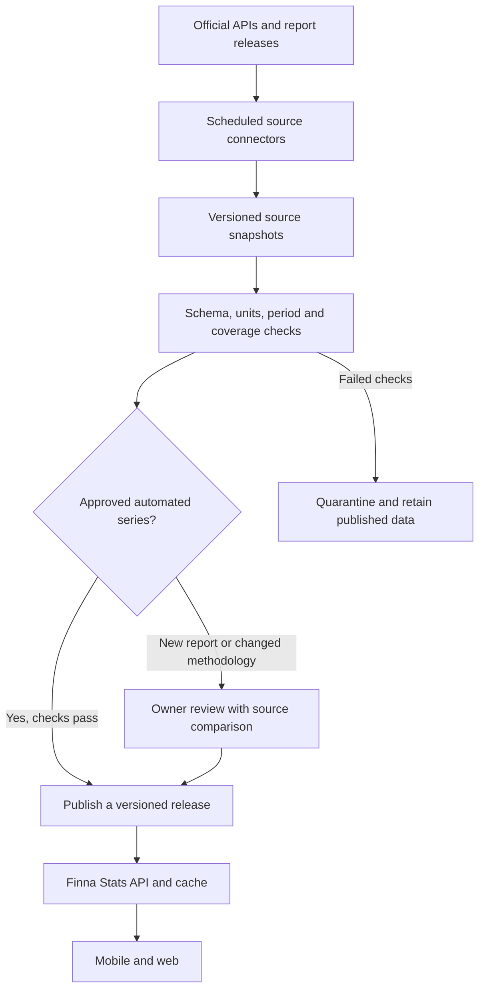

# Finna Stats — India, world rankings and Economic Survey

Design proposal · 15 November 2026 · Implementation not started

## Product

Add **Stats** to Library → Study tools beside Atlas and Chronicle. Keep the
existing five bottom destinations. Its purpose is to help learners understand
India's position, compare places, and revise dated facts with their sources.
This is separate from learner XP, game standings and personal study statistics.

Use the existing native Figtree typography, navy text, blue primary actions,
yellow highlights, semantic light/dark surfaces and rounded cards. Reuse native
screen, card, sheet and typography components. At 390px, use one main column,
44px minimum actions and a horizontally scrollable section selector. Larger text
must wrap without covering values, source labels or the bottom navigation.

## Screens and interactions

| View | Content | Main action |
|---|---|---|
| India | Economy, population, health, development; a short selection of India's published ranks | Open a metric or compare countries |
| Rankings | Searchable index catalogue, category filters, India's rank, score, coverage and edition | Open the index leaderboard |
| States | Indian state/UT comparisons with Mizoram easy to select | Compare within the report's eligible group |
| Economic Survey | Edition picker, chapter briefs, sourced key figures, tables and revision cards | Read a chapter or its original table |

Proposed routes: `/stats`, `/stats/indicator/[id]`, `/stats/index/[id]`,
`/stats/compare`, `/stats/states`, `/stats/survey/[edition]`,
`/stats/survey/[edition]/[chapter]`. These are proposed, not existing app routes.

### India landing wireframe

```text
‹ Library                                  Sources
Stats
India in numbers

[India] [Rankings] [States] [Economic Survey]

INDIA AT A GLANCE
GDP growth                              [value] %
Data: [period] · [provider]                  View ›
Life expectancy                     [value] years
Data: [period] · [provider]                  View ›

INDIA IN THE WORLD                       View all ›
Human Development Index
Rank [rank] of [coverage] · Score [score]
[edition] · Data: [reference period]          View ›

ECONOMIC SURVEY
[edition] · Ministry of Finance
Chapters · Key figures · Statistical appendix  ›

Home       Exams       Library       Desk       Me
```

Bracketed fields are placeholders, not invented statistics. Missing values show
“Not available for this period”; unconnected sources show “Not yet available”.
Do not show zeroes, fake trends or “live” labels to fill the layout.

### Indicator and ranking detail

Lead with the India value/rank, metric definition, unit, publisher and edition.
Below it: History, Compare, Methodology, Source. History provides an accessible
table alongside the chart. Let users compare India with up to three other places;
default to a common period and show missing observations rather than mixing years.

A published index leaderboard pins India above the paged country list, shows
ties, scores and the number of assessed places. A position change is shown only
when comparable releases support it. Show a methodology-break note otherwise.
Every detail has a source link and a visible data period. The expanded source
panel adds publication date, revision, last successful check and update method.

“Health” is a category, not one universal health ranking. Keep life expectancy,
infant mortality and health expenditure as separately defined measures. NITI's
State Health Index belongs under States, with the publisher's larger-state,
smaller-state and UT groups preserved. Mizoram must not receive an invented
all-India rank by combining those groups.

### Economic Survey

Use the official **2025–26** edition currently listed by the Ministry of Finance
as the initial candidate. Preserve earlier editions and each original source.

Each chapter contains a concise reviewed brief, key figures with page/table
citations, definitions and exam revision prompts. The appendix supports table
search and explicit units. Keep actuals, provisional/revised/advance estimates
and forecasts visibly distinct. Financial years must remain financial years.

Newer monthly or annual statistics can appear in a separate “Since this Survey”
section; they never silently replace what the Survey originally reported.
Chapter briefs and practice questions are reviewed content, not automatic API
output. A historical quiz pins its edition and answer; later revisions can add
a dated update without changing that attempt's scoring.

## Source strategy, verified against official documentation

| Source | Suitable content | Access and publication approach |
|---|---|---|
| World Bank Indicators v2 | GDP, GDP growth, GDP per capita, population and selected health/economic series | Documented API without an API key; stable approved series can refresh automatically after validation |
| UNDP HDRO DataPRISM | HDI and related development indices | Current documentation advertises APIs and downloadable tables; validate authentication, dataset identifiers and release metadata during integration |
| WHO GHO OData | Defined health measures | Documented OData API; select all relevant dimensions, including age/sex and units; do not use retired Athena |
| Henley Passport Index | Passport rank and destination-access score | Official methodology/report imports with review; no public reuse API was verified in this research; establish permitted reuse/access before automation |
| NITI Aayog | State Health Index and future approved state indices | Official report tables, reviewed by edition; preserve eligible comparison groups |
| Ministry of Finance | Economic Survey chapters and statistical appendix | Detect official edition/file changes, extract candidate tables and review before publication |
| MoSPI eSankhyiki | Indian macroeconomic releases | Official API availability is described by PIB; confirm supported public endpoints, terms and series contracts before promising an automated connector |

Initial catalogue: nominal GDP, real GDP growth, GDP per capita, population,
consumer-price inflation, life expectancy, infant mortality, HDI, Henley Passport
Index, NITI State Health Index and Economic Survey. Confirm exact series metadata
before enabling each connector. Additional indices can use the same registry
after checking publisher, methodology, access and reuse rights.

The World Bank request below was attempted on 15 November and returned HTTP 502
from this environment. Its public API is documented, but this is not a successful
integration test. No latest numeric value is claimed or imported by this proposal.

```text
https://api.worldbank.org/v2/country/IND/indicator/NY.GDP.MKTP.KD.ZG?source=2&format=json&mrnev=3
```

## Update architecture



Use the existing FastAPI/PostgreSQL backend with a scheduled worker and HTTP
cache; a new standalone service is unnecessary for the first version. Mobile
reads Finna's published snapshots, not several external APIs on every page view.

Proposed checks: API series daily, report landing pages weekly, Economic Survey
daily during its expected release window. These are polling intervals, not
promises that publishers release new measurements daily. Only actual successful
checks advance `last_checked_at`; only a changed accepted release advances
`last_updated_at`. Schedule jobs only during implementation, not from this design.

Connector contracts include timeouts, bounded retries/backoff, pagination,
provider rate limits, conditional requests where supported and idempotency by
source content hash. Preserve permitted raw snapshots privately, with hash,
fetch time and source URL. An unchanged response creates no duplicate release.
Publish the complete validated release atomically; partial fetches never replace
a complete leaderboard. On failure keep the last good data and show a delayed
check notice when its source-specific freshness threshold is exceeded.

Auto-publication is enabled per source/series only after its mapping and
validation policy are accepted. New series, methodology/unit/base-year changes,
unexpected coverage changes and suspicious jumps enter review. PDF extraction
and AI summaries always enter review. Extraction confidence is not verification.

## Data contracts

| Entity | Required information |
|---|---|
| Source | Publisher, canonical URL, documented endpoint, access/attribution terms, connector, cadence, health and last successful check |
| Metric | Stable ID, exact provider code, title, definition, category, unit/scale, population dimensions, geography, frequency, direction or neutral status |
| Release | Source, edition, publisher release date if known, fetch time, reference period, methodology version, source hash, validation/review status, superseded release |
| Observation | Release, place ID, period, dimensions, raw numeric value, unit, estimate status, uncertainty bounds where supplied, missing-data reason |
| Ranking | Release, place, publisher rank, score, assessed population, comparison group, tie rule; derived rankings explicitly flagged |
| Survey section | Edition, chapter/table ID, original URL/page, source hash, structured figures, reviewed brief and review attribution |
| Import run | Connector version, start/end, success/failure, counts, validation errors, diff and resulting release IDs |

Distinguish publisher release date (nullable when unknown), observation period,
Finna fetch time and Finna publication time. Never substitute one for another.
Keep source revisions immutable and link replacements. Two providers' differing
estimates remain separate series, not an averaged or silently overwritten value.

For a Finna-calculated ranking, label it “Calculated from [provider] data”. Use
one period, consistent units/dimensions and an explicit eligible-country list;
exclude regional/income aggregates. Report coverage and missing countries. Define
the tie rule and numeric precision before ranking. Never present a derived rank
as a publisher's official index, or call a larger population/GDP morally better.
Retain the publisher's own tie rule for published rankings.

## Proposed API surface

```text
GET /api/stats/overview?country=IND
GET /api/stats/metrics?category=health
GET /api/stats/metrics/{id}/series?places=IND,BGD&from=2015
GET /api/stats/indices/{id}/releases
GET /api/stats/indices/{id}/rankings?release_id=...&cursor=...
GET /api/stats/states?metric=...&release_id=...&group=...
GET /api/stats/surveys
GET /api/stats/surveys/{edition}/chapters/{chapter}
GET /api/stats/sources
```

Return release IDs, period, source links, freshness and missing-data information
with every data response. Comparisons pin their release/period; cached responses
use ETags. Public reading can be anonymous. Saved revision items are account
scoped; connector credentials stay server-side. Review/import controls use the
existing protected staff identity, never the learner mobile token. Use an
allowlisted source registry rather than arbitrary user-supplied fetch URLs.

## Delivery sequence and acceptance

1. Build the native Stats shell, source registry, release storage and one World
   Bank connector. Show only supported published data and honest empty states.
2. Add HDI, health series, country comparison and dated ranking detail. Verify
   publisher access and exact metadata before enabling automation.
3. Add Economic Survey import/review, NITI state comparisons and passport-index
   releases after permitted data access is established.
4. Add saved revision cards and reviewed practice, then further indices.

Acceptance checks: null is not zero; financial/calendar years cannot mix; API
pagination is complete; country aggregates are excluded; publisher ties survive;
rank deltas require comparability; state groups remain separate; stale/failed
fetches preserve the last good release; source corrections remain auditable;
concurrent/replayed imports are idempotent; client cache pins releases; staff-only
publication is enforced; offline data displays its period; charts have readable
tables and work in dark mode and at larger text sizes.

This document creates no production tables, scheduled jobs, live Stats routes,
provider accounts or subscriptions. Implementation and deployment remain future
work; the existing app and question bank were not modified.

## Primary references

- World Bank API: https://datahelpdesk.worldbank.org/knowledgebase/articles/889392
- World Bank call structure: https://datahelpdesk.worldbank.org/knowledgebase/articles/898581-api-basic-call-structures
- UNDP downloads and current API links: https://hdr.undp.org/data-center/documentation-and-downloads
- UNDP DataPRISM docs: https://prism.hdrdata.org/docs/
- WHO OData: https://www.who.int/data/gho/info/gho-odata-api
- WHO Athena retirement: https://www.who.int/data/gho/legacy
- Henley methodology: https://www.henleyglobal.com/passport-index/methodology
- NITI State Health Index Round IV: https://www.niti.gov.in/node/366
- Economic Survey: https://www.indiabudget.gov.in/economicsurvey/
- MoSPI portal: https://esankhyiki.mospi.gov.in/
- PIB on eSankhyiki API: https://www.pib.gov.in/PressReleaseIframePage.aspx?PRID=2076859&lang=2&reg=3

## Implementation checkpoint — 15 November 2026

The first Stats release is implemented and its API/update timer deployed. The
opening “Implementation not started” label describes the original proposal.
Current feature coverage, source review, validation, receipts and explicit future
extensions are in [FINNA-STATS-OPERATIONS.md](FINNA-STATS-OPERATIONS.md).


Website extension (15 November 2026): public Stats is now available at
https://study.hawayu.in/stats using the same production API/releases as mobile.
See FINNA-STATS-OPERATIONS.md and reports/stats-web-20261115 for current coverage,
automation boundaries, build/regression checks and deployment evidence. This does
not mark the later content/owner-review frontend phases complete.
