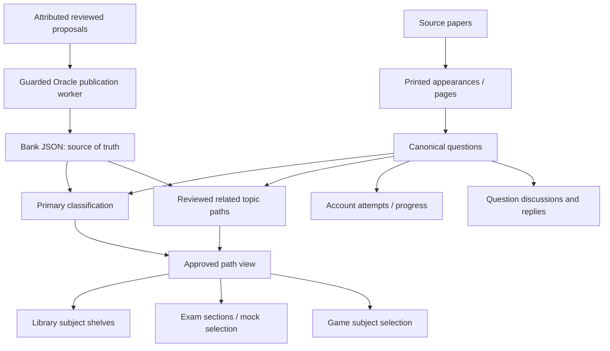

# Subject-first Library and reviewed topic links

Current tagging decisions follow [Question tagging rules](QUESTION-TAGGING-RULES.md).
Publication follows the [Oracle runbook](ORACLE-PAPER-WORKBENCH-RUNBOOK.md).
The measurements below describe this feature's original release, not today's audit.

The Library opens on Subjects. Geography, History, Polity, Economy, Science, Environment, Mizoram GK and Current Affairs are direct shelves. Modules & tools and Saved notes sit beside them. All General Studies and the complete broad-subject catalog remain accessible. Shelves are database-defined queries over approved classifications, not copied questions.

Each shelf has Practise, Browse, Notes and Discussions. Practise uses answerable questions; the strict verified-key pool is optional. Browse includes descriptive and unkeyed items. Search, topic/subtopic, public exam, original year, paper/community origin, provenance and account progress filters use URL state with ten-question pagination. Clear filters preserves the selected view. Progress without an exam filter includes attempts from across the account. Source details remain on question cards. Current Affairs carries an original-year warning. Regions are not inferred from stems; geography-specific regions need reviewed taxonomy expansion later.

## Data model

0044 adds bank-owned `question_topic_links`, approved-only `v_question_paths` and versioned deployment seed `library_shelves`. Geography maps to general-studies/geography; History combines Indian/World History; Economy includes both General Studies economy and Economics. These are discovery shelves and do not promote broad tags to more precise classifications. A question with several matching links is counted/rendered once. Existing primary classification, paper context and question ID remain stable.

`relatedClassifications` is a separate explicit list in bank JSON. Parked alternative model claims in `classifications` are NOT imported as related topics. Each path has a subject and optional topic/subtopic, publication provenance and review status. Contributions can add/remove up to twelve related paths through the existing taxonomy proposal type. Valid active parent/level paths, distinct paths, subject scope on all affected reviewer/publisher permissions, immutable revisions, baseline checks and normal worker receipts apply. Owner decisions and independent-review decisions retain their actual attribution under the current workflow; a model must not fabricate either. The server never publishes question tags directly. Publication writes the canonical Oracle bank, exports primary/secondary CSV separately, syncs transactionally and verifies live paths against the receipt. Empty-path removal has an explicit reversible [] before-value. Old immutable revisions without secondary paths keep their baseline shape.

The classification-only and full sync paths replace secondary links from explicit bank data in the same transaction. Secondary path collisions across multiple appearances of a canonical question resolve deterministically by primary appearance then appearance ID. A failed import rolls back with primary classifications. No synthetic secondary links or reclassifications are seeded in production by this release.

## Notes, discussions and visual administration

Published materials match shelves through their explicit existing subject or tags (shelf slug, canonical taxonomy IDs or case-insensitive shelf title). Creating a note from a shelf prefills its tag. Paid bodies/drafts stay behind existing access/publication controls. Discussions use the same question's approved paths and existing answer/disclosure, mock/game, approval and bilateral block gates. People can ask doubts from a question card or submit a new practice MCQ through independent review; votes do not approve answers.

Owner console `/admin/bank?tab=database` provides a visual database map: selectable table cards, live counts, connected relationships and missing-topic coverage. The API is owner-only and returns aggregate counts, never personal rows, credentials or question keys. This is an application-level map, not a generic SQL editor.

## Limits and next data work

The new structure enables richer classification; it does not fill the 56,294 existing missing primary topics. Further taxonomy additions (Indian/world/physical geography, regions and historical periods) need versioned registry changes and reviewed links. Legacy broad-subject displays retain their primary path; question discovery, section counts, mock selection and game filters accept related paths. Account subject statistics retain primary categorisation so category totals are not multiplied. Library subject totals use distinct canonical questions; topic totals may overlap and must not be added together.

Backfill accuracy, source-key gaps and answer adjudication remain separate work. No difficulty labels, automatic correctness by upvotes, inferred region metadata or automatic public community publication were introduced. Pagination, permissions and publication tests use disposable fixtures; no load certification is claimed.

## Live performance follow-up

Initial production verification found ~4.3s shelf lists and taxonomy aggregation. 0045 replaces redundant global UNION deduplication with UNION ALL: branch primary flags differ and source path keys are already unique. Learner queries still use EXISTS/distinct canonical IDs. Shelf selection uses a set query, taxonomy totals aggregate one materialized eligible set, and count queries omit an unused classification join. This change is a new migration; applied0044 remains immutable. Shelf year filters also require a real printed appearance in that year and prefer that printing in the source card, rather than matching only the interval between first/last appearance. Exact-year behavior has an isolated regression test.

Final release validation:134 full-suite tests and32 focused review/library cases pass (one upstream deprecation warning). Final single external observations: Geography practice0.405s, Browse0.400s, taxonomy0.898s, collections1.663s. Collections' subject/topic lookup was split into indexable branches and paper membership uses EXISTS; a production read-only comparison preserved the exact60-row result hash. These are measured requests, not capacity guarantees. Account switches invalidate pending audience-filtered UI requests immediately. No-op tag reordering/empty-path changes earn no publication credit, and unchanged related tags do not expand answer-correction reviewer scopes.
