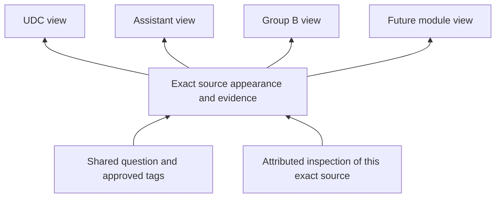

# Shared review for exam modules

Status: shared review and source-paper module composer deployed, 4 November 2026.
See the delivery boundary for supported selection types and validation limits.

## Product decision

Keep one Review workspace for original exams, compiled modules and future modules.
The chosen module decides what work the reviewer sees. Original source identities
and shared question identities decide what a review or correction applies to.

Reviewing the same unchanged source through UDC, Assistant or Group B must not
require three inspections. A different appearance of that question can still need
its own source check: option order, printed wording, answer keys and diagrams can
differ. The module name alone is never evidence that two sources are equivalent.

Extend the current simplified editorial system. Do not create a review dashboard,
question bank, publication queue or compulsory approval chain for each exam.

## Starting point at design time

- `editorial.py` paper/question progress selects checks by assignment ID as well
  as appearance ID. A check in one assignment is therefore not currently credited
  in another assignment that contains the same source.
- `editorial_access.py` already fingerprints source, answer and explanation
  evidence separately from strict write-conflict tokens. Reuse this distinction.
- `admin_bank_edits.py`, `admin_answers.py` and the publisher already support final
  authorised admin decisions, conflict detection and recorded publication.
- `EditorialReviewContext` already displays other module uses and existing work.
  Its collection-paper join describes source-library membership; it is not an
  exact prediction of every filtered subject area or future compiled module.
- Existing membership includes live collection papers, section queries, pins and
  excludes, plus Group B approved tags and explicit source roles. A parent is not
  automatically the union of every question from UDC, Assistant and related links.

The main work is a common scope resolver and reusable inspection read model, then
one improved module overview. Existing correction forms and publishing remain.

## Keep three decisions separate

| Decision | Identity | Where the result applies |
| --- | --- | --- |
| Correct shared tags/content | Canonical question ID, field/aspect and current revision | Every use of that shared value after verified publication/sync |
| Inspect or fix the original source | Exact appearance ID, paper and evidence fingerprint | That source wherever it appears; another booklet/year is not automatically inspected |
| Include a question/paper in a module | Module definition/version, source rule or explicit selection | That module and explicitly dependent compiled modules |

Source-specific answer overrides and explanations keep their existing scope.
The preview must distinguish a shared correction from an appearance-only edit.
“Checked” remains an inspection: it does not make an answer official, remove a
hold, change scoring eligibility, or complete an independent publication review.



The diagram illustrates reuse, not a claim that every source belongs to all four
modules. Actual membership is resolved from the current published definitions.

## Everyday reviewer experience

Entry points: a role-aware **Review this module** action on an exam/module home,
the existing header/More review link, and the admin dashboard. Learners do not see
staff actions. The server enforces access independently of visible navigation.

Keep the current three destinations: **My work / Needs attention / Completed**.
One searchable module chooser replaces nested exam/assignment/paper dropdowns.
Remember the exact module, paper, appearance and queue position in the URL.
My work shows accessible scopes and Continue; owner access must not require
inventing an assignment. Assignment management remains under Manage.

Module overview layout:

```text
Review workspace                   [Find a module or paper]
My work             Needs attention             Completed

Group B Non-Gazetted                         [Continue]
Review coverage: checked / relevant source appearances
Already checked through other modules · Remaining · Needs attention

[Questions] [Source papers] [Module setup]

Needs attention: [All] [Tags] [Source / answer] [Submissions]
Search within this module                   Sort: Next useful work

Original source                 Status           Next action
Assistant & UDC — Paper I       Work remaining   Continue
Technical — Paper III          Needs source     Open issue
```

This is a wireframe, not live inventory. Actual rows, counts and progress must
come from authorised, deduplicated records. Module setup is collapsed/secondary
and restricted to permitted administrators; it is not another daily review stage.

Questions defaults to one row per canonical question for tag/content issues,
with the relevant source appearances expandable. Source-paper review preserves
printed order and one row per appearance. A reviewer must know which kind of list
they are in; never silently collapse different booklet appearances into one check.

Question view:

- Original paper, year, question number and source/PDF action at the top.
- Question, answer provenance, explanation and searchable topic chips.
- A compact “Also used in…” line, showing exact permitted modules. Expand to see
  source differences and previous reviewer/date/aspects; never expose private drafts.
- **Checked & next**, **Edit**, **Cannot verify**. Skip remains navigation only.
- Existing valid work appears as “Already checked by …”, with **Next unchecked**
  as the natural action. No synthetic review is attributed to the current user.
- Edit opens the relevant inline form. Preview names the actual affected scope.
  Admin: **Save & publish**. Assigned-only reviewer: **Submit correction**.
  Publishing/failed/applied status remains visible; failure retains the draft.

On phones, use a list-to-question flow and a collapsible source panel. On tablets,
show list/detail only when both remain readable; the PDF stays optional. Keep
44px controls, visible focus, sticky actions above the bottom navigation, and no
table wider than the screen. Follow existing paper surfaces/Newsreader styling.

## Shared checks and disagreements

Resolve inspection evidence by exact appearance and inspected aspect, not by the
current module/assignment. Preserve reviewer, original assignment, time, attestation
and fingerprint. Reuse an existing record; do not copy it into each assignment.

A current positive check is reusable only when the recorded aspects apply to the
question type, the attestation is valid, and its relevant fingerprints still match.
Legacy checks without usable fingerprints use the existing conservative version
fallback; never backfill today's content as if it had been inspected earlier.

Source/text/options changes reopen source and dependent answer/explanation work.
Answer/key changes reopen answer and explanation work. Explanation changes reopen
explanation work. Tag-only changes affect classification and membership evaluation;
they do not reopen a matching source/PDF inspection. Strict save tokens still
reject stale edits even when an inspection aspect remains current.

Do not choose an arbitrary positive check while ignoring an unresolved contrary
check, source hold or material report. Show **Needs attention** with the exact
conflicting evidence. An authorised admin can settle an issue in the same edit or
inspection action, with a recorded reason and links to the evidence it resolves;
there is no compulsory second administrator. A generic new check cannot silently
dismiss unrelated reports. Applied corrections close only their linked issues
after verified readback. Historical checks and dissent remain visible.

Account revocation stops future access; it does not silently delete legitimate
historical inspection evidence. Invalidated/retracted evidence needs an explicit
append-only resolution record. Such a record must not rewrite prior attestations.

## Honest progress without repeat work

Primary progress: **current checked source appearances / relevant source
appearances**, evaluated for the selected published module scope. Count each exact
appearance once even when several child modules select it. Show “Already checked
through other modules” as a subset of checked, never add it to the numerator again.

Keep canonical question totals separate from appearance totals. Tag issues and
shared question corrections deduplicate by canonical ID and issue/aspect. A source
problem deduplicates by appearance/evidence identity. Parent totals come from set
unions, not addition of child percentages or question counts.

Maintain independent facts internally: inspection freshness, open issues and
publication state. A summary badge uses: publication failed / unresolved issue,
then publishing, then stale, then unchecked, then checked. Display the underlying
counts with explicit units. “Checked” is not “no issues”; **Review complete** requires
all relevant inspections current and no unresolved blocking work or pending/failed
corrections. Zero relevant sources means **No sources**, never 100% complete.

Next useful work: publication failures and blocking source/answer issues, then
changed checks, unresolved reported tags, unreviewed sources and optional tag gaps.
Missing topics are coverage gaps, not automatically wrong tags. Within a queue use
stable source order or recorded issue age with a deterministic ID tie-breaker.

Example (illustrative): UDC and Assistant both include appearance A. Group B also
selects A. One valid inspection of A contributes once to each relevant view and
once to the Group B total. Appearance B has the same canonical question in another
paper: shared tags are reused, but B's source check is still outstanding.

## Module membership and future modules

Introduce a server-side `review_scope` service that returns distinct canonical IDs
and qualifying source appearances, selection reasons, definition versions, and
capabilities. Apply access limits before returning rows, counts or impact details.

Adapters:

1. Registered source-paper sets and frozen reviewer assignments.
2. Existing collection papers and section predicates, pins and excludes.
3. Group B common/English/GK/technical scopes using the existing membership helper
   and exact science-role/question-range rules.
4. Explicit curated question selections when an exam module uses them. Community
   practice-set publication keeps its existing separate policy.
5. Future compiled modules referencing registered scopes with explicit approved
   filters, exclusions and pinned selections; reject cycles and unknown selectors.

No arbitrary client SQL, keyword inference, automatic LDC inclusion, or automatic
technical-to-common promotion. MPSC/Website bank origin remains visible and is
intersected with each scope. Similar question text is not authority to merge IDs.

Use the same definition of membership for learner views, review counts and change
impact. Extract/reuse existing query helpers with parity tests first. Current
collection/section/source queries differ in purpose; do not replace them with a
simple paper union. A parity mismatch must be resolved explicitly before enabling
the new badge/count for that scope.

Module setup shows linked sources and current inclusion reasons. **Remove from
this module** changes its versioned selection, not bank content or a global tag.
**Correct tags** changes shared taxonomy and may change multiple tag-selected
modules. Show proposed entrants/exits before a membership change or affected tag
change; revalidate on save. An intentional pin has an explicit reason and must
never bypass holds, access restrictions or scoring eligibility.

A future module is configured from registered sources/rules and capabilities:
MCQ/written/mixed, study areas and applicable inspection aspects. No new review
page is needed. Existing question/source checks become visible automatically;
new sources and new module-selection decisions remain work to do. Written-only
modules do not require MCQ keys/options or show fabricated grading readiness.

Use a scope revision derived from collection versions, role/config versions and
membership-relevant taxonomy/publication revisions. Refresh affected counts after
sync. If an included question leaves a filtered module during editing, preserve
the open draft/source context and explain the move. Recheck actual write access;
never silently save to a different question or broaden an assignment.

## Permissions and publication

Existing global/scoped owner/publisher grants govern final decisions, including
both old and target subjects for retagging. Active assignments permit inspection
and proposals only for their frozen exact paper set. A compiled module is a
view, not a permission grant. The visible scope is the intersection of module
membership and current authority; label partial scope as **Your accessible work**.

A new child module or added paper must not expand an assignment automatically.
Return aggregate shared-use context only within permissions; hide restricted
module names/details. Preserve active assessment answer gates and MFA requirements.
Independent public-submission review and paper-intake requirements are unchanged.

Reuse existing idempotency, question locks, baseline/source tokens, evidence
validation, Oracle publication and verified readback. Preview shared versus local
impact; do not introduce bulk answer changes or bypass integrity holds. Bank edits
are never direct SQL writes. Attempts, original source IDs and historical review
records remain unchanged.

## Implementation slices

### 1. Reuse current inspections

Add `api/app/services/editorial_status.py` to resolve qualified current checks for
exact appearances across assignments. Keep assignment-local activity as a separate
field for “My work”; global coverage must not pretend the current reviewer did it.
Add an index on `(appearance_id, id DESC)` in the next available numbered migration.
Existing writes remain valid. For owner/publisher checks outside an assignment,
make `editorial_checks.assignment_id` nullable for new records and add explicit
origin scope/revision columns, with a constraint requiring either the original
assignment or a complete origin scope. Preserve all old assignment values. Add
`POST /editorial/checks` for these direct checks: resolve exact source membership,
current inspection capability/subject grants, assessment gates and source tokens
server-side. Do not accept an arbitrary origin or use this endpoint to expand an
assigned-only reviewer's access. Store the actual actor and authorisation context;
do not manufacture a personal assignment to satisfy the old foreign key.

Add an append-only issue/evidence resolution table
only for the new explicit resolution action; reference exact check/report IDs,
aspect, baseline fingerprint, actor, reason and idempotency key. Historical positive
checks alone cannot infer that an earlier conflict was resolved.

### 2. One module overview and context

Add `api/app/services/review_scope.py`. Proposed additive endpoints under the
existing editorial API: scopes, scope overview, scoped work list and question
impact. Return authorised counts, source-selection reasons, scope revision,
existing evidence references, publication state and capabilities. Strictly validate
registered scope IDs/selectors; keep existing assignment endpoints operational.

Extend `EditorialReview`, `EditorialPaperOverview`, `EditorialReviewContext` and
`reviewNavigation` rather than creating exam-specific copies. Add module entry
links to generic exam homes and Group B. Keep old URLs and continue positions.
Use the existing source/question editors and tag-cleanup filters.

### 3. Compiled-module setup

Add the versioned definition adapter and admin membership preview after the
existing UDC/Assistant/Group B scopes pass parity tests. Prefer existing collection
version storage where expressive enough; add a dependency relation only where
necessary. Admin publication of module selection is audited and atomic. Preview
new versions, keep the prior published scope during drafting, and preserve frozen
assignments. Do not migrate live module content by broad name matching.

### 4. Performance and release

Batch source fingerprints and status lookup for visible pages; avoid a whole-bank
scan or one query per question on each click. Scope caches by permission identity,
definition revision and publication state; invalidate on grant/assignment changes.
Counts and rows use the same predicates and stable paging. Benchmark with overlapping
modules and source-heavy archives, comparing to the existing list latency.

Rehearse additive migrations on a disposable clone. Release read-only scope/status
first, compare old/new totals, then enable the new entry and optional setup. Retain
the old assignment route for rollback. Do not reset checks or make synthetic human
reviews in production. Build locally and use existing deployment scripts.

## Acceptance checks

- The same appearance in UDC/Assistant/Group B receives one reusable inspection;
  two appearances of the same canonical question need distinct source checks.
- Overlapping children do not inflate parent counts, issues or completion.
- A tag correction reaches shared uses after sync but does not certify content;
  an appearance-only repair does not silently change other source variants.
- Source, key and explanation changes reopen only the applicable dependent work;
  stale saves are rejected and drafts survive. New unresolved evidence blocks a
  misleading completed state until an explicit valid resolution.
- Role-bounded science, technical papers, section pins/excludes and explicit
  question selections match actual learner membership. Wrong-tag removal changes
  filtered membership while leaving source archive access intact as appropriate.
- Written/mixed papers and future modules require no MCQ-only attestation.
- Assigned-only users cannot gain access through a parent module; no private
  drafts, hidden answers or restricted module details leak. Revocation clears UI.
- Publishing failure, retry and duplicate clicks remain correct and idempotent;
  resolved-report state appears only after successful verified application.
- Adding/removing a child refreshes module coverage without resetting valid source
  evidence, modifying attempts, expanding assignments or silently absorbing new IDs.
- Empty/loading/error states and keyboard/phone/tablet flows retain a clear next
  action. Back/refresh preserve scope and exact source position.

## Delivery boundary

The shared-review core (slices 1 and 2) is live. Migration 0074 preserves existing
checks and adds attributed direct inspections and append-only conflict resolutions.
Scope adapters cover published collection/section definitions, pins/excludes,
exact assignments and Group B source roles. Future modules using these definitions
can use the same workspace without a new review page. Paper queues retain exact
appearance identity; existing tag cleanup handles canonical deduplication separately.

Slice 3 is deployed as an owner-only source-paper library composer. Module setup
supports unpublished new modules, saved drafts, searchable paper selection,
imports from published module paper libraries, exclusions, before/after counts,
explicit publication reasons and immutable version history. Self/circular imports,
cross-bank sources, stale drafts/previews and conflicting retry keys are rejected.
Imported libraries are snapshots: source-module changes require a fresh preview
and publication, never silent propagation. Current Group B roles remain separate.

This editor composes paper libraries; it does not treat a child module's filtered
learning area as its whole library. Existing section filters, pins/excludes and
paper rules are preserved, apart from explicit source removals. It does not expose
arbitrary query editing or new per-question pin/subject-rule controls. Those advanced
selectors remain API/configuration concerns. The tag shortcut still uses the source
collection scope rather than claiming exact learning-area filtering.

Validation includes 115 backend regressions, frontend component/navigation checks,
local production build, disposable-clone migration rehearsal, service health and
production preservation hashes. No synthetic human checks, bank-content edits or
permission changes were made. Signed-out phone/tablet entry widths passed;
authenticated visual/physical-device QA remains pending. See DEVLOG.md and
EDITORIAL-WORKSPACE.md for release details.
