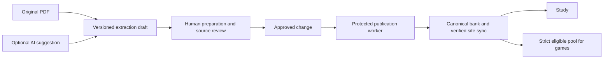

# Website and paper workspace design

2 November 2026 · Proposed product design and implementation contract.

This is a design, not a claim that the new workflows are deployed. It is grounded in the current React routes, admin navigation, paper intake/extraction code, assigned-review workflow and games selection APIs. Preserve the existing visual system in DESIGN-FIDELITY.md. This document consolidates future work; historical plans are not reliable evidence that a feature is still missing.

## Outcome

The owner can add an exam paper, prepare questions, delegate source checking, review corrections and publish from the website. Friends can work through assigned papers without understanding JSON, terminal commands, model prompts or database tables. Students can find their exam, study its papers and join suitable games through a consistent layout.

Generative AI is optional and off by default. Selectable-text extraction, reusable layout rules, human editing and local OCR handle the normal path. OCR itself may use trained recognition models; the promise is no required chatbot/API calls or per-question generative processing. Poor scans, handwriting, diagrams and complex mathematics still require human work. Do not promise an accuracy percentage before measuring real papers.

## What exists and what needs work

| Area | Current source evidence | Proposed next step |
| --- | --- | --- |
| Paper discovery | Exam inventory, sortable exam/year archive, paper viewer and PDF links | A single paper record linking source, question preparation, review and publication |
| Intake | PaperIntake tracks stages; its file control computes a checksum locally rather than uploading a PDF; extract-paper-intake.py produces text/artifact files using pdftotext | Guided PDF upload, background extraction, visual preparation and recovery |
| Human corrections | Versioned proposals, source evidence, owner publication, exact assigned-paper access and immutable inspection checks | One queue and contextual next action; preserve underlying safeguards |
| AI conflict protection | Protected UDC/Prelims records/assets, guarded writers and sync; stale edits rejected | Carry these controls into every new import/reprocessing path |
| Games | Solo modes, duels, private party and weekly cup; current GameSetup/games.py also provide selections, previews, matching contexts and readiness | Consolidate navigation and admin operations; verify remaining gaps against code before implementation |
| Administration | Existing grouped navigation, inventory, quality, corrections, reports, publication, people, audit and community tools | Simplify task entry and integrate paper work and game operations |

This is a source-code audit, not a new production gameplay or capacity test.

## Whole-site information architecture

Two explicit workspaces share accounts and source data: Study and Administration. Eligible staff get an account-menu switch. An assigned friend lands on My review work and sees only permitted tasks. Navigation visibility accompanies server authorization; it never substitutes for it.

### Study workspace

Desktop navigation: **Home · My exam · Library · Games · Community**, with search, notifications and account controls. Home is the signed-in study dashboard; retain the public landing page for visitors. Study desk, progress, saved items and account settings remain easy to reach through Home/account. Community contains feed, creator materials and discussion; it does not replace study navigation.

Mobile bottom navigation: **Home · Exam · Library · Games · More**. More contains Community, Study desk, progress, saved items and account. A live timed test/game has its own focused shell with an explicit exit action. Use the same names on desktop and mobile.

| Screen | Layout and main action |
| --- | --- |
| Home | Chosen exam and Continue study first; next useful revision task; upcoming relevant exam notice; recent progress; optional game invitation below study work. Empty state asks for an exam. |
| My exam | Stable exam title and scope; Overview / Subjects / Papers / Mock tests / My progress. Subject shortcuts reflect actual source coverage, including written work. |
| Papers | Search plus exam, year, subject and booklet filters. Rows show exam, sitting/year, paper/subject, booklet, source availability and review coverage. Oldest/newest/name sort; URL preserves filters and pagination. |
| Paper | Original PDF / Questions / Practice or timed mock where eligible. Preserve printed numbering, shared passages, diagrams and source links. A historical paper is not automatically a current exam blueprint. |
| Library | Subject → topic → learning material and questions; approved taxonomy only. Carry selected exam scope into filtered study and display it visibly. |
| Revision and progress | Mistakes, saved questions, actual attempt history and revision tasks. Explain practice accuracy and coverage separately; do not imply exam readiness from XP. |
| Community | Discussions, notes, creators and reports. Keep community claims distinguishable from official source material. |
| Account | Profile, security, sessions, plan/rewards and privacy; eligible users can open Administration or My review work. |

One question presentation is reused in practice, paper review and game results where access allows. Keep provenance readable, distinguish official keys from reviewed unofficial answers, and never infer answer confidence from a green layout colour.

### Administration

A task-oriented sidebar, with secondary tools inside each section:

1. **Overview:** resume current paper, unassigned work, blocked sources, submitted corrections, failed publication jobs and game incidents. Counts link to their exact filtered queues.
2. **Papers:** Add paper, exam/year inventory, preparation queue, source files and coverage gaps.
3. **Questions:** search, source-aware editing, learning tags, missing answers, written questions and quality checks.
4. **Review:** assignments, submitted corrections, source checks, reported issues and paper completion summaries.
5. **Publish:** ready changes, preview, queue, failures, publication history and corrective revisions.
6. **Games:** usable question pools, mode availability, event preparation, results/incidents and operational status.
7. **Community:** materials, discussion and study-desk moderation, calendar/notices.
8. **People & settings:** explicit grants, assignments, account support, audit, worker status and backups. Technical references stay under an advanced subsection.

Preserve old /admin/bank tab URLs and links during migration. Group the existing tools before replacing individual screens; avoid rebuilding functioning authorization and publication services.

## Add paper: the normal workflow

### 1. Upload and identify

Upload a PDF or select an existing archived source. Show cover/first pages immediately. Capture exam, recruiting authority, year/sitting, stage, paper title, subject, language, booklet and question/answer-key document type. Keep original filename separately from the display title. When the name exists only inside the PDF, the operator selects/copies it from the cover and confirms the exact exam identity. Record evidence page/region and whether metadata was manually confirmed.

Do not require the filename to contain the exam name. Allow Unknown with a visible completion blocker rather than inventing a title. Identical file hashes return the existing source; differently scanned editions become candidates for human comparison, not automatic merges. A source may need multiple paper sections when one PDF bundles several papers.

### 2. Read the pages

Detect text per page. Extract selectable text first; use local OCR only for pages lacking usable text. The operator can rotate a page, choose its reading columns, omit headers/footers and rerun a selected page. Preserve original bytes and record tool version/settings alongside each extraction revision. Mixed text/scan PDFs must not be treated as uniformly one type.

Offer a saved layout preset such as single column, two columns, options A–D, numbered MCQs, comprehension passage or written paper. Preview on a few pages before applying it. These are deterministic parsing rules with manual overrides; a shared exam label does not guarantee a shared layout.

### 3. Prepare questions beside the source

Desktop workbench:

```text
Exam · Year · Paper · Draft saved                    Save draft | Send to review
[question list] [original PDF + zoom/page controls] [editable question + preview]
Q1 complete     Source page / printed page           Stem / shared instructions
Q2 needs split  Selected source region               Options / figure / passage
Q3 missing key  Crop / rotate / text selection        Answer evidence / explanation
                                                      Tags / issue / Next question
```

Resizable panels with persistent widths. On smaller screens, PDF and Editor are tabs with the current question retained. Phone review is supported; multi-column page segmentation is primarily a desktop task. Large worklists use pagination/virtualization rather than rendering an entire bank.

Core controls: start a question here; split; merge adjacent extracted blocks; continue on next page; reorder options; attach/crop figure; attach shared passage; preserve underline/table/formula; select written/MCQ type; undo; previous/next. Page-region coordinates belong to the original PDF coordinate system so zoom/rotation do not move evidence. Keep printed question labels, physical PDF page and printed page number distinct.

Autosave private drafts with visible Saved/Saving/Offline/Conflict status. Unsaved text survives a recoverable request failure; another person's edit triggers comparison, never silent last-write-wins. Keyboard shortcuts supplement labelled buttons and do not fire inside text inputs. Show the student rendering before submission.

### 4. Attach answer evidence

Upload/select a key document or enter key rows in a simple grid: booklet, question number, answer, source page and key edition/date. Preview mapping and detect missing numbers, repeated numbers, ambiguous options, withdrawn questions and booklet mismatches. Never align an answer key merely by row order or import an unofficial solution as an official key.

A human confirms evidence and mapping. Keep official source keys, human explanations and optional AI suggestions separate. Missing answers remain missing. Written responses use rubric/marking guidance where present and do not acquire MCQ scoring by import.

### 5. Check completeness and assign

Show counts with denominators: expected/located questions, source text checked, options/figures checked, supported answers, explanations checked and unresolved issues. Missing expected count is an explicit unknown. Flag broken numbering, empty/duplicate options, missing crops, orphan passages and unresolved exam identity. Deterministic flags are checks to investigate, not factual verification.

Assign exact source papers to named reviewers. Sangzel keeps UDC; Solomon keeps Prelims. Permit paper-by-paper progress and a reviewer note. Assignment changes do not silently expand frozen scope. A reviewer can mark Cannot verify and continue; completion requires an explicit accounting of blocked items.

### 6. Review and publish

Reviewers inspect the PDF, submit versioned corrections and record source checks. Owner sees a diff, evidence, conflicts, affected source appearances and scoring impact before publication. Preserve existing independent-review requirements and bounded owner workflows. Shared canonical changes must display which other papers are affected.

Separate states: draft saved, source checked, correction approved, publication queued, published, publication verified. A checklist tick neither publishes nor makes an answer official. Keep incomplete papers available as source PDFs if deliberately approved for archive visibility, while blocked questions remain excluded from scored play.

Publication runs through the protected canonical-bank workflow. Display queued/running/failed/verified status and a usable retry action. Undo of a published change means an audited corrective revision with impact review, never deleting history.

## Data, processing and independence from AI



Retain the current single canonical-bank authority. The future browser workflow needs a durable job bridge to the host that owns the canonical bank: upload and extraction can stage artifacts, but only the protected publisher applies approved changes. If that host/worker is offline, show Queued—publisher offline; never report success or write bank-owned SQL directly. Eliminating daily terminal work requires operating this worker reliably, not merely adding a Publish button. Moving canonical ownership to a hosted workspace would be a separate migration with verified backup/cutover, not a second writable bank.

New storage concepts should be additive: immutable source assets; extraction runs; page blocks/regions; draft questions and shared content; reusable layout presets; key-document mappings; job attempts and receipts. Reuse existing paper/question IDs, proposals, assignments, checks and audit events after identity is confirmed. Per-field/source provenance preserves original extraction, human revision and publication links.

Workers need persistent job IDs, bounded retries, cancellation, progress, resource/time limits and idempotent completion. Validate PDF type and size, quarantine parsing failures, sandbox document processing and restrict fetched source URLs. Authenticate source access and avoid sending documents to external models unless explicitly selected. Preserve audit/retention rules and source backups; test restoring a paper and its review trail.

Reprocessing creates a candidate revision and a comparison against the reviewed version. It never replaces protected human work. New extraction versions are accepted per reviewed change, with stale-source checks and current assignment scope. Preserve the existing UDC/Prelims baseline and publication journal.

Optional AI appears only in an Assist drawer: selected block/question, explicit task, previewed scope, visible usage/cost limits, result labelled suggestion, and Accept into draft. No automatic whole-bank reprocessing, answer verification or publishing. Ordinary upload/edit/review/publish must be demonstrably usable with AI disabled.

Technical references: the existing pdftotext script already provides a non-generative extraction path. [PDF.js](https://mozilla.github.io/pdf.js/getting_started/) supplies browser PDF rendering APIs; editable region selection is application work. [Tesseract documentation](https://tesseract-ocr.github.io/tessdoc/ImproveQuality.html) explains the effects of skew, image quality and page segmentation; OCR output still needs source review. Benchmark actual English/Mizo papers and formulas before selecting OCR presets or promising language quality.

## Games as part of the same product

Games home: **Play solo · Play with friends · Weekly cup**, followed by recent results. First show the existing exam/recent-practice/subject selection and usable pool preview. Keep explicit mixed selection and exclusions where supported. Use the current backend mode/rule definitions rather than duplicating constants in a new shell.

| Journey | Design contract |
| --- | --- |
| Solo | Choose scope → choose mode → inspect question count/timing → start → result → review mistakes/practise. Preserve Gauntlet and Speed identities. |
| Friends | Host selects scope and mode → share private code → every participant sees identical rules and acknowledges readiness → start → common results and optional rematch. |
| Random duel | Match the same confirmed context; show actual waiting state and cancel. Broader selection is an explicit user action. |
| Weekly cup | Show schedule, entry rule, eligible set and result-release policy; freeze the shared set. Future subject tracks require their own correctness/fair-ranking release, not just UI filters. |
| Results | Score, correct/wrong/excluded counts, source context, answer review when permitted and links to practice. Personal practice history and competitive ranking are clearly distinguished. |

Game screen: compact rules/timer at top, accessible question/options in the centre, submission/connection status below. Avoid moving controls, celebratory obstruction or reward popups during a timed question. Reconnect resumes the original server session; the browser does not calculate authoritative scores.

All scored modes keep strict official/key eligibility and complete usable figures/options. Human-checked unofficial answers can support labelled study, but never fill a ranked game shortage. Underfilled pools show actual available/required counts and offer explicit scope changes. Do not introduce difficulty labels, auto-generated opponents, invented player counts or a separate game question bank.

Game administration needs: eligibility/exclusion counts by scope and mode; preview of event rules and source set; event draft/schedule/close/cancel with audit and permissions; reported questions and sessions; failed finalizations; reconnect/availability diagnostics; visible reward policy and receipts. Admin preview must respect active-game answer access rules and avoid giving participating staff early answers. Read-only operations can ship first; event mutations require matching APIs and tests.

Changing a mode's rules produces a new version and affects future sessions only. No arbitrary point editing. Question/key corrections need consistent exclusions for all competitors, with recorded reasons and separate original/final assessments where relevant. Audit the current cup correction behavior before promising fair comparisons across staggered entries. Reuse current reward deduplication/caps, blocks, privacy and answer-release protections.

## Visual and interaction system

Retain warm paper backgrounds, existing typography and source-based card/option tokens from DESIGN-FIDELITY.md. Improve hierarchy and navigation before repainting. Area colours identify subject/product areas; correctness uses the established semantic states with text labels. Administration uses denser rows and functional whitespace; student pages give reading space; games use a focused session layout.

Every asynchronous view has loading, empty, permission-denied, failed, retry and stale-data states. Destructive actions identify the affected paper/event and consequences. Tables collapse into labelled mobile rows without hiding year, identity or status. Minimum 44px interactive targets, visible focus, keyboard navigation, meaningful labels, reduced motion and no colour-only status. Maintain exam/filter/source context on back navigation, login redirects and reopening saved work.

## Delivery sequence and release gates

| Packet | Deliverable | Acceptance before release |
| --- | --- | --- |
| 1. Screen designs and navigation | Detailed desktop/mobile designs for study home, exam archive, paper workbench, reviewer queue, admin overview and game lobby/session; route migration map | Walk through all three roles; preserve existing links; compare against prototype tokens; distinguish real controls from mockups |
| 2. Paper workbench pilot | Upload, cover identity, text extraction, manual segmentation, draft save and original-side preview | Owner prepares one real selectable-text paper entirely in the browser with AI off; no canonical content changes before approval |
| 3. Scans and key mapping | Page OCR, layouts, figures/passages, key-grid import and source validation | Exercise a poor scan, two-column paper, passage/written paper, multi-page question and mismatched booklet key; verify recovery after failure |
| 4. Review and publication integration | Assignment queue, evidence/diff, source locks, protected worker bridge and verified receipts | Two reviewers editing concurrently cannot overwrite one another; stale parse rejected; failed sync recoverable; owner publishes without terminal use |
| 5. Student shell consolidation | Home/My exam/Library/Community navigation, responsive archive and continued-study links | Mobile and desktop journeys, existing URLs, active mock continuity, honest source labels and empty states pass |
| 6. Games consolidation and operations | Lobby/setup/results refinement, admin pool diagnostics then audited event controls | Underfilled pools, two-account ready/reconnect flow, duplicates/retries, correction during game, reward limits and privacy pass |
| 7. Operational handoff | Short owner/reviewer manuals, job diagnostics, backup/restore exercise and maintenance ownership | Owner adds another paper unaided; Sangzel and Solomon complete a review exercise; restore verification recorded |

Do not estimate a calendar delivery date until representative paper complexity and worker hosting are measured. Pilot with copies of sources; no bulk re-import of the protected collections. Release each packet behind its own checks while keeping the existing site usable.

Measure: human minutes to prepare a paper; extracted vs manually fixed fields; AI calls/cost per paper; missing questions/figures; reviewer reopens/conflicts; time to verified publication; worker failure recovery; game selection failures and abandoned queues. Record real baselines before setting numeric targets. The overall acceptance criterion is successful owner-led paper intake and friend-led review with AI disabled, plus a coherent student/game journey.

## Current-affairs connections provision

Before implementing the new question workspace or games, read `CURRENT-AFFAIRS-TIMELINE-DESIGN.md`. Reserve a reviewed, dated “Then and now / Asked again” panel and a Current affairs connections admin queue. Keep source questions, historical keys and current fact revisions separate; connect GS/GK questions through precise entities and approved taxonomy. Apply related-answer disclosure checks to timeline APIs during active assessments. This is proposed future work, not an existing automatic update system.

## 3 November delivery

The first complete browser paper workbench, Oracle canonical publishing runtime, student navigation changes and Topic Trail are now implemented and deployed. Existing editorial, exams, study desk, community and admin routes are preserved. Real reviewers still supply source/key inspection and final sign-offs; no AI parsing or taxonomy approval substitutes for that. See `ORACLE-PAPER-WORKBENCH-RUNBOOK.md` for the live workflow, backup/restore procedure, exact permissions, resource limits and pilot scope.
