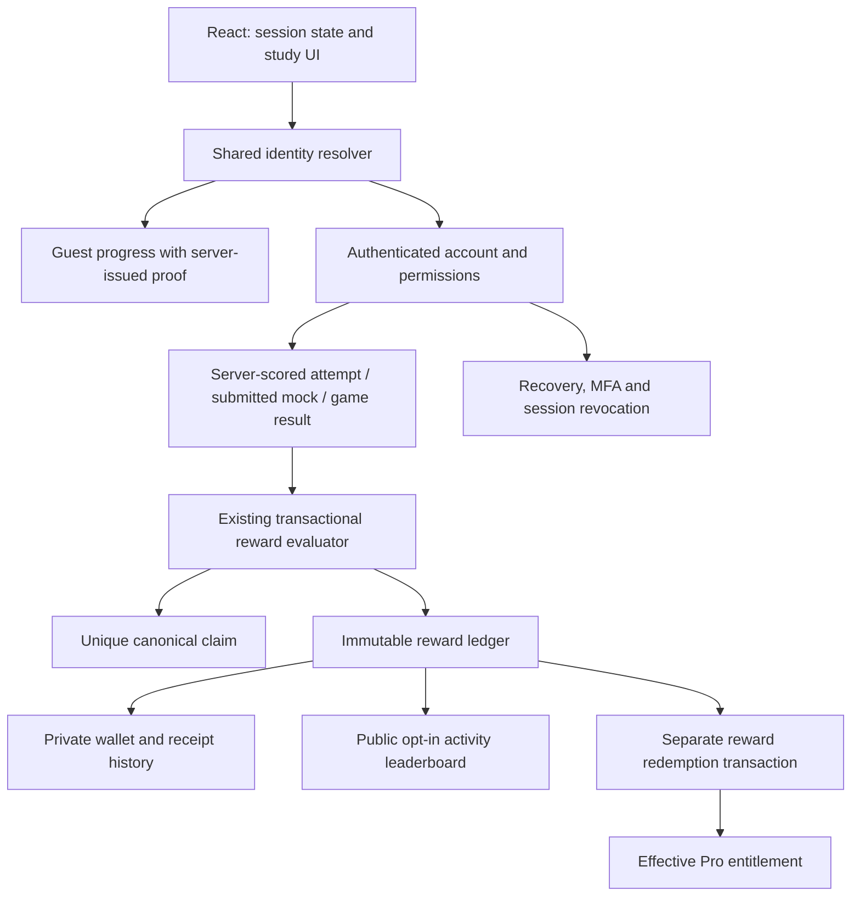

# XP, leaderboard and authentication — Sol 6.1 implementation handoff

Prepared 29 October 2026. Status: **implementation completed in the follow-up; see docs/ACCOUNT-XP-AUTH.md and reports/account-xp-hardening-20261029 for release status and remaining mail/load dependencies**. Owner request: solidify experience points, leaderboard, authentication, workflow and system design for Sol to implement. EXP means XP here. Current product is Mizoram MPSC only. Read CLAUDE.md, PLAN.md, DECISIONS.md, DESIGN-FIDELITY.md and docs/LEARNING-REWARDS.md first. Preserve the existing card design and small outer gutters.

## Outcome

A learner can browse as a guest, sign in safely, resume the same exam, understand precisely why XP was or was not earned, control public visibility, and recover an account. The owner can investigate reward/session issues from audit records without editing totals or impersonating learners. Extend the existing FastAPI/PostgreSQL/React system; no new auth provider, microservice, duplicate wallet or rewrite is required.

## Observed implementation and gaps

These are local code findings, not an exploit test or fresh production security certification. Bank sync checked IN SYNC: 80,547 canonical questions and approved classifications. No production writes made for this review.

| Area | Exists | Work to close |
| --- | --- | --- |
| Accounts | Password hashing with scrypt, hashed 30-day session tokens, HttpOnly cookie, register/login/logout/password change | Recovery and email verification absent in inspected auth router; UI explicitly says recovery delivery is being configured |
| MFA | Authenticator setup, recovery codes, single-use validation, recent verification and staff guards | Integrate with shared session state and structured errors; preserve current guards |
| Guest progress | Client UUID and device user; `_adopt_device` moves selected tables at register/login | UUID is explicitly not authentication, yet supplied UUID selects history to adopt; establish proof before transfer, inventory newer progress tables and handle collisions |
| Session resolution | `current_user`, `require_account`, review identity and `/auth/session` | Expired session can silently fall back to device user on mixed routes; origin/CSRF handling differs between route families |
| XP | Immutable ledger, unique canonical claims, transaction locks, 300 daily study/game XP cap | Expose award receipts/reasons; centralize rule metadata and reconciliation; test concurrent awards |
| Games/mocks | Server results and calls to shared award function | Preserve once-per-question behavior across all contexts; remove stale “games will” wording after verification |
| Board | Public opt-in; weekly/monthly/lifetime; dense rank | Add own placement and explicit period boundaries; offset past end currently returns total zero because count travels only on result rows |
| Login navigation | Some callers construct `?next=` | Account form always navigates to `/profile`; safely restore intended exam/page |
| Corrections | Original activity rewards preserved; contribution/content reversals append negative entries | Make policy visible and adjustments auditable; never silently recompute historical rewards from new keys |

Primary code: api/app/routers/{auth,auth_mfa,rewards,me}.py; api/app/deps.py; api/app/services/{review_identity,mfa,games,content_studio}.py; api/migrations/0034_learning_rewards.sql,0035_content_studio.sql,0043_games_and_search.sql; web/src/screens/{Account,AccountSecurity,Rewards,Profile,Scoring}.tsx; web/src/lib/{api,review,device}.ts. Inspect later migrations before editing any behavior. Never edit applied migrations.

## Product rules to retain

1. Exam marks, XP, spendable reward points, contribution credit and Pro entitlement are distinct. XP describes activity, not exam readiness or official MPSC rank. No paid ranking boost.
2. First **rewarded** correct canonical question: 10 XP + 1 point, official/key proof only, maximum 300 study/game XP per India calendar day. Practice, mocks and games share the cap and claim. Wrong, repeated, guest, late-mock and unofficial-solution attempts do not award question XP. Reviewed unofficial answers remain useful practice but are not official-key reward evidence.
3. A question encountered after the daily cap is not consumed as a reward claim. A later eligible correct attempt can earn its first reward. No automatic next-day backlog payout. Display “Daily XP limit reached; your practice was saved.”
4. Existing publication credit and reviewed material rewards retain their current policies, separate from the study/game cap. The existing board includes these XP categories: explain this in the UI and expose a breakdown. Do not quietly redefine historical ranking as practice-only. Contributor reputation remains its own board.
5. Lifetime level retains `max(1, floor(sqrt(max(0, XP)/40)))`. Level 1 covers 0–159 XP; level 2 begins at 160. Show progress relative to the actual lower threshold (0 for level 1). Test 0,39,40,159,160,359,360. Do not rebalance earned levels in this task.
6. Public visibility defaults off. Joining exposes handle, avatar, rank and XP only. Email, name, wallet, exam history and internal identifiers stay private. Private accounts receive their own XP summary with no public rank.
7. Keep existing points balances and owner unlimited access intact. Reward redemption stays disabled until separately enabled by the owner; no billing launch or trial-policy change in this work.
8. Ordinary answer corrections preserve original activity rewards. Abuse/publication reversals use explicit compensating events, not rewritten history. Wallet debt may exist after reversal; do not clamp the ledger balance or permit redemption against insufficient net points.
9. One canonical claim across UDC, LDC, Assistant and other MPSC exams. GK/GS presentation and Science filters do not create another reward identity. No exam-specific leaderboard in the first release: shared questions make attribution a separate design problem.

## System design

Postgres remains the authority. Commit attempt, claim and award consistently; never display success from client-calculated correctness or an optimistic XP increment. Reuse the existing trigger/function award path instead of introducing a second competing writer. A response serializer can look up the award receipt after the transaction. Notifications and email use a durable outbox if added; failures must not roll back completed learning or mint duplicate rewards. Avoid a Redis leaderboard until measured query costs justify it.

### Authentication and session contract

- Introduce a shared resolver returning explicit guest/account/expired states. Separate optional read access from account-required mutations and staff permission checks. An expired cookie must not silently record an intended account mutation as anonymous; return structured 401 and preserve unsent work. Explicit guest browsing remains available.
- Session response: authenticated state, minimal user profile, effective entitlement, expiry, MFA enrollment/recent verification, and session-bound CSRF token. Never expose raw cookie token/hash, password hash or MFA secrets. Private responses use `Cache-Control: private, no-store`.
- All cookie-authenticated mutations require consistent same-origin and session CSRF validation. Login/register/recovery have deliberate pre-auth same-origin protection; do not accidentally require a logged-in CSRF token to log in. Keep existing review clients compatible during migration and audit every router, not just auth.py.
- Frontend session provider states: loading, guest, authenticated, expired, unavailable. A network outage is not logout. A successful login/logout changes account cache generation, cancels stale requests and clears private cached results. Propagate across tabs using BroadcastChannel or storage event, with no credentials in storage.
- Preserve validated same-origin relative `next` through login/join/MFA. Reject absolute URLs, protocol-relative URLs, backslashes/control characters and auth loops. Default to `/profile` only when no safe target exists. Preserve exam filters; never store passwords or submitted answers in a redirect URL.
- Keep MFA optional for learners and enforced for protected staff mutations as configured. Require current credentials/recent MFA for sensitive changes; reset email must not bypass enabled MFA or silently disable it.
- Provide session list and revoke-one/revoke-others; opaque session IDs, approximate device label and last activity, never tokens. Rate-limit activity updates. Password recovery revokes all sessions and requires fresh sign-in. Rotate the retained session on password change; preserve current MFA protections.

### Guest transfer: fix trust before convenience

Current `X-Device-Id` is forgeable. Do not expand `_adopt_device` based only on that value.

1. Add server-issued unpredictable guest proof in a Secure HttpOnly same-site cookie, store its hash, bind progress created with that proof to its guest principal. Require proof for subsequent private guest-history reads/writes as well as transfer. Keep public question reads independent.
2. Do not attach a fresh proof to arbitrary preexisting UUID history supplied by the browser; that would preserve the weakness. Start a new protected guest principal. Legacy unproven server history stays unclaimed; design an explicit documented transition, with no automatic ownership grant. Locally available filters can still be carried as preferences.
3. After successful sign-in, offer “Save this browser’s guest progress to your account” with counts. Transfer only proven guest-owned learning data. Use a unique one-use transfer receipt and lock source/target; two account logins cannot claim the same guest history.
4. Inventory all user foreign keys. Specify each table: transfer, merge, retain or exclude. Include attempts, mocks, exam bookmarks/checkpoints, learning checkpoints, module progress, vocabulary state, drafts, notifications and relevant saved items. Never use a generic dynamic “move everything” loop. Do not transfer roles, plans, wallet, MFA, sessions or staff authorship by device header.
5. Deduplicate set membership; choose latest server-updated checkpoint; preserve submitted results; keep at most one active mock under existing constraints and show any conflict. Do not rewrite immutable attempt evidence blindly: determine whether an ownership mapping is needed before choosing updates. No retroactive guest XP.
6. After transfer or logout rotate guest identity to protect shared devices. Show a transfer receipt and retry safely after lost response.

### Recovery and email verification

Add hashed random, purpose-bound, short-lived single-use tokens; store user, expiry, consumed time and request metadata. Consume atomically. Verification and password-reset tokens are distinct. Generic request responses avoid disclosing account existence. Bound requests by IP and account identifier using atomic limits; verify trusted proxy configuration before using forwarded IP. Current count-then-insert login limits deserve concurrency tests. Run password hashing off the async event loop with bounded concurrency; preserve existing hash compatibility.

Email delivery is an external dependency: build/test against a local sink, use existing configured provider if present, otherwise document the exact missing deployment settings. Never claim production recovery works before a real controlled delivery test is authorized and completed. Do not auto-mark existing emails verified. Existing accounts retain access while verification is introduced; add resend and clear status. Do not block existing rewards behind verification without a separately versioned policy. Keep recovery disabled with honest copy until delivery is configured. Store no plaintext passwords or reset links in logs; token landing pages use no-referrer and no third-party scripts.

### Reward receipt and rule contract

Keep current endpoints; add fields compatibly:

- Wallet: rule version, breakdown by source, level floor/next threshold, daily remaining, server reset time, effective points, visibility.
- Attempt/result: `reward.status`, XP/point delta, receipt ID if awarded, rule version, and stable reason code (`awarded`, `already_rewarded`, `daily_cap`, `guest`, `unofficial`, `incorrect`, `late`, `ineligible`). Return only caller-owned receipts. A retry returns the original award receipt and never a new award. Separate receipt existence from UI “newly awarded” animation; deduplicate by receipt ID.
- Reject conflicting payloads with the same attempt idempotency key. Handle practice, submitted mocks and games through their existing server result contracts. Results expose aggregate and per-question outcomes without leaking answers before submission.
- Persist version and source references on new ledger events (attempt/publication/material/reversal). Keep historical entries readable as legacy-v1; backfill only mechanically provable references. Do not guess source exam attribution or manufacture proof.
- Add read-only reconciliation report: duplicate/missing claims, ledger/claim mismatch, cap anomalies, reversal links, wallet debts and unknown legacy attribution. Start with report-only; repairs require exact audited compensating events.

### Leaderboard contract

Keep `/board`, default month; week starts Monday 00:00 Asia/Kolkata, month starts first day 00:00. Return `period_start`, `period_end`, `as_of`, rule version, total and optional caller-only placement. Equal net XP uses dense rank; stable secondary ordering uses an internal immutable account ID, not mutable handles. Do not return that ID publicly.

Compute totals independently of page rows, including empty/out-of-range pages. Initially preserve offset pagination with bounded size and document that a live board can move between pages. Use one consistent database snapshot per response. No fake seasonal reset jobs: query time boundaries. Negative corrections retain their actual ledger posting period under the existing policy; do not relocate them silently. Zero/negative totals are unranked. Test opt-out immediately across all public endpoints and caching paths. Default no public cache until invalidation is proven; private placement is never shared-cache content.

UI: period switch; compact own-XP/placement card; readable boxed list; equal-rank explanation; empty/loading/retry states; privacy toggle confirmation with rollback on failure. Display “MPSC learning activity”, never official exam rank or ability percentile. Keep contributions visible in the scoring explanation. No forced opt-in, purchased boosts, public email or invented competitor data.

## Implementation sequence and acceptance gates

| Order | Work packet | Completion evidence |
| --- | --- | --- |
| P0-A | Baseline route/data ownership inventory; session/CSRF resolver and expiry behavior | Route authorization matrix; guest/account/staff tests; no account-to-guest write fallback; existing review MFA tests pass |
| P0-B | Protected guest identity and bounded adoption | Forged UUID cannot read/transfer victim history; simultaneous claims to different accounts have one winner; repeat receipt stable; no XP or entitlement transfer |
| P0-C | Frontend session provider, safe return navigation and account isolation | Login resumes exact UDC/LDC/Assistant filter; expiry retains draft; offline is not logout; logout in tab A removes private data in tab B |
| P1-A | Recovery, verification, sessions/revocation | Token expiry/reuse/concurrency; generic request responses; rate limits; MFA not bypassed; delivery sink evidence and separate production readiness status |
| P1-B | Reward rule metadata, receipts, ledger references and reconciliation | Real PostgreSQL concurrent awards across contexts; 300 cap; replay same receipt; unofficial excluded; historical XP unchanged |
| P1-C | Board totals, own placement, period metadata, privacy and UI | Ties; midnight/week/month boundary; empty pages; immediate opt-out; private placement not exposed; responsive UI |
| P2 | Admin diagnostics and operational polish | Read-only account reward timeline, correction references, security events, reconciliation export and documented incident workflow |

For every packet: inspect existing tests first, implement a small cohesive slice, run relevant isolated tests and build if frontend changed, record evidence, then move forward. No need to rewrite already working billing/MFA/game systems. Preserve compatibility across API/frontend deployments. Do not parallelize schema or identity changes across agents without explicit authorization.

## Required test matrix

- Duplicate canonical question across UDC, LDC, Assistant, GK→Science, mock and game awards once. Different source appearances do not mint extra XP.
- Two simultaneous correct attempts at daily 290 XP: exactly one award, total 300; no partial claim without ledger event. Same test with 10+ competing requests and actual app database role.
- At cap, no claim consumed; next India day a new correct attempt may earn. Client clock/timezone irrelevant.
- Guest adoption gives no historical XP; later new eligible attempt follows existing first-reward policy. Wrong→correct can earn; correct→repeat cannot.
- No awards for held/defective/unofficial evidence; source snapshot and strict eligibility both honored. Submitted/non-late mock only. Test key changes preserve historical reward policy.
- Publication and material reversals replay once; insufficient or negative wallet blocks redemption; catalog remains disabled. Unlimited owner entitlement survives.
- Account A→logout→B and stale in-flight responses never show A's history, wallet, MFA status or checkpoints. Invalid session cannot become privileged via device header.
- CSRF absent/wrong origin; stolen UUID without proof; reset expired/replayed; MFA recovery reuse; session revoke immediately effective; safe return URL malicious cases.
- Board with ties, one row, zero rows, final page, beyond end; different period boundaries; private account absent everywhere; own placement includes no other private account data.
- Browser checks at 390px and desktop: keyboard flow, password-manager autocomplete, code entry, visible errors, pending submission states and no horizontal overflow. Preserve boxed cards and shared gutters.

Existing regression starting points: api/tests/test_rewards.py, test_mfa.py, test_games_search.py, test_scoring_revisions.py, test_content_studio.py, test_learning_workflows.py; web/tests/navigation.test.mjs. Run with the repository isolated PostgreSQL fixture, never synthetic users/awards on production. This planning session did not rerun those tests or claim they currently pass.

## Release and operations

Use additive numbered migrations; rehearse on a production dump clone using the repository runner. Keep raw credentials and user data out of reports. Baseline existing balances, claim counts, opt-in counts, effective entitlements and query plans with aggregate/read-only evidence. Deploy backend compatibility first, then frontend built locally. Rollback application code with compatible schema retained; never drop ledger/session history as rollback. Feature-gate recovery email and new guest transfer until their end-to-end checks pass; failure must be explicit, not fallback to unsafe legacy transfer.

Monitor aggregate login failures/rate-limit hits, recovery delivery failures, award outcome counts, duplicate-event conflicts, reconciliation anomalies and board latency. No passwords, tokens, email addresses or answer bodies in metrics. Define initial targets: ordinary board/wallet server p95 under 500ms at representative load, no duplicate awards, no over-cap awards, immediate revocation/opt-out. Measure before claiming targets met.

If systemd/Postgres/Caddy is touched, verify both study.hawayu.in and family.hawayu.in. Preserve disabled checkout/redemption and named owner unlimited Pro. Append DEVLOG each session, update completed checklist entries only after evidence, and report remaining dependency blockers plainly.

## Copyable Sol follow-up task

Read `docs/ACCOUNT-XP-AUTH.md` and `reports/account-xp-hardening-20261029/STATUS.md` first. The implementation is deployed; do not rebuild completed packets. Remaining work is controlled SMTP configuration/delivery acceptance, representative load/operational monitoring, and any independently discovered defects. Preserve existing rewards, MFA, private board default, protected guest ownership, MPSC scope and owner unlimited Pro. Use additive migrations and isolated tests. Do not send emails, enable redemption/billing, create another chat or delegate without the relevant user authorization. Report measured outcomes and remaining dependencies plainly.
