# Community contributions and bank review — implementation specification

Status: designed on 2026-10-20; implementation and deployment are NOT complete.
Owner request: a reliable user contribution/review system, with a handoff another model can implement. This document specifies the complete launch scope and its acceptance gates; it is not evidence of production readiness.

## 1. Outcome and boundaries

Learners can propose answers, explanations, transcription repairs, taxonomy corrections, source references, new MCQs against registered papers, and duplicate/defect reports. Appointed reviewers assess the exact submitted revision and evidence. Accepted changes are published through the canonical local bank, appear in every consuming exam/module, and carry traceable attribution. Authors see progress and reasons for decisions. Corrections remain reversible and historical scores remain explainable.

Launch includes contributor pages, reviewer workspace, account permissions, structured evidence, decision history, publication tooling, notifications, contribution credit, estimated-score integration, tests, operations and rollback. All tasks in IMPLEMENTATION.md are required before calling this feature complete.

Launch does not include arbitrary PDF uploads, an AI judge, a new discussion platform, cash rewards, automated canonical merges, or a second bank. Source evidence uses registered PDFs and cited links. New paper ingestion remains the existing bank workshop's responsibility; the UI explains how to request a missing paper, using a persistent `source_request` contribution. Duplicate reports produce a reviewed duplicate relationship or defect hold, not an automatic merge. These boundaries are explicit product scope, not buttons backed by placeholders.

## 2. Repository findings to preserve

- React/TypeScript in `web/`; FastAPI/psycopg/PostgreSQL in `api/`; numbered migrations are checksum protected.
- `api/app/deps.py`: `current_user` accepts guest device identity; new contribution writes require a valid account session directly, without device fallback. `require_account` exists but reviewer privileges need a separate explicit permission check.
- `api/app/routers/auth.py`: HTTP-only hashed sessions exist. Email ownership verification and recovery have no configured delivery provider. Never label these accounts email-verified. Staff provisioning is an operator action with an audit event until verification/MFA is delivered separately.
- `api/app/routers/moderation.py`: shared owner bearer token is for conduct moderation. Do not reuse it as a volunteer identity or grant permissions from display ranks.
- Migration `0004_sync_log.sql` already defines `bank_feedback` and `sync_log`. Extend their publication integration; preserve existing rows/status semantics.
- `content_reports`, `posts`, `abuse_reports` already exist. Conduct reports stay in moderation; discussion stays attached to the canonical question. A feed item links to a contribution and uses existing answer-reveal rules.
- `scripts/sync-bank.sh` owns bank content; users, contributions and review history are server-owned. The bank is `../mpsc-question-bankv2/bank/mpsc_bank_v2.json`.
- Canonical API IDs (`cq_…`) differ from bank appearance IDs. Resolve through `appearances`; never derive an appearance from a canonical hash. Store both IDs and the exact paper/printed number/option order.
- Existing `v_scorable` means official/key only. `derived` currently does not establish review history. Add a reviewed estimate pool rather than relabeling every old derived answer as reviewed.
- Sync inspection found the canonical UPDATE change predicate compares stem/options/source/key reference/explanation but omits answer-text-only changes. Fix and regression-test this before publication can be enabled.
- Existing `trg_cr_hold` changes canonical status after a report threshold. Reconcile it with the explicit server-owned hold design below; do not let sync accidentally erase a hold or public vote floods control correctness.

## 3. User experience and Claude v3 fidelity

Use `docs/design/India Study Map v3.dc.html`, contribution block beginning around line 2080, plus the bank inline error form around line 443. Read `docs/DESIGN-FIDELITY.md` before building. Preserve the supplied typography and spacing; amend demo promises when actual permissions differ.

Specific contribution tokens: max width 1240px, main padding 36px 24px 96px; Newsreader heading clamp(36px,5vw,52px), weight 500; body 17px/1.6; stats border #1D1B18 and radius 8px; contribution grid minmax(260px,1fr), gap 18px; cards padding 20px/radius 8px; two columns flex-basis 440px/gap 40px. Question diff uses existing bank option styling. Use 44px minimum touch targets even where prototype demo controls are smaller.

Routes:
- `/contribute`: real personal statistics; ways to contribute; paginated papers needing answers; personal submissions; reviewer queue preview only when permitted.
- `/contribute/new?question=…&appearance=…&kind=…`: source context, typed proposal form, rationale/evidence, diff preview, saved draft and submit.
- `/contributions/:id`: revision, source, progress timeline, public reviewer reasons, request-changes response, appeal, publication receipt. Owners/reviewers see private content; public users see only published/redacted summaries.
- `/review`: cursor-paginated queue, filters by kind/subject/paper/state, age and impact; assignment/lease indicator and counts.
- `/review/:id`: current-bank/submitted diff, original source locator, independent answer entry where applicable, evidence comparison, decision controls, audit timeline.
- Account/profile: contribution attribution, publication credit, notifications and links to own submissions.

States: loading, empty, offline, draft saved, submit failed with retry, invalid evidence, permission revoked, stale revision, lease expired, rejected, changes requested, accepted awaiting publication, publication failed, published, superseded and reverted. Preserve unsaved text on transient errors; do not cache private drafts on a shared browser after sign-out. No fabricated queue counts, rank, reviewer votes, or completion percentages. A paper's denominator is its actual eligible questions, not 100.

Use keyboard-operable forms, labeled fields, visible focus, error summary plus field errors, screen-reader status announcements, non-color-only status labels, mobile single-column layouts, and source links with page/booklet context. Review source opens a safe new tab. If a mock is active, defer answer-revealing contribution details for its questions until submission, including direct API reads.

## 4. Permissions and policy

All contribution mutation endpoints require an authenticated account, same-origin/CSRF protection and server-side authorization. Free and paid accounts have equal contribution access. Device IDs, subscription tier, reputation and client-supplied roles never grant review rights.

| Actor | Allowed |
|---|---|
| Guest | Published redacted contributions, subject to answer reveal rules; sign-in prompt for writes |
| Contributor | Own drafts, submit/revise/withdraw before acceptance, provide evidence, appeal once per decision revision |
| Reviewer | Read queue in assigned subject/paper scopes; claim work, request changes, approve/reject; cannot decide own contributions |
| Senior reviewer | Adjudicate conflicting reviews and appeals in scope; cannot hear their own prior decision or approve their own proposal |
| Publisher service/operator | Export accepted immutable revisions, apply guarded bank patch, sync, acknowledge publication; cannot manufacture reviewer votes |
| Owner | Grant/revoke explicit scoped reviewer roles and suspend contribution access, with reasons/audit; cannot bypass evidence/quorum silently |

Permissions live in a dedicated grant table, separate from `users.role` reputation labels. All queries enforce scope; reviewer lease ownership is not a permission. Roles and account suspension are rechecked inside the decision transaction and at export.

Decision quorum: answer/option/stem/new-MCQ/official-provenance/defect/duplicate changes require two distinct non-author reviewers on the same revision; at least one senior reviewer for changing an official key or resolving a disagreement. Explanation, valid taxonomy and source locator changes require one non-author reviewer. A disagreement blocks acceptance and goes to senior adjudication; adjudicator cannot be the author. Lack of eligible staff leaves the item pending. No automated/AI approval.

Any content revision invalidates prior approvals. A reviewer must propose an amendment as a new revision; they cannot edit the proposal underneath approvals. Reviewer revocation invalidates unexported approval eligibility; already published historical decisions remain visible and trigger a reassessment queue if warranted.

## 5. Evidence and scoring

Typed contribution kinds: `answer`, `explanation`, `transcription`, `taxonomy`, `source_reference`, `new_question`, `duplicate`, `defect`, `source_request`.

- Answer: target appearance, proposed answer by stable option identity/text plus original index, worked rationale, requested provenance, evidence references. No naked letter as identity.
- Official key: registered source PDF hash and page; exam/year/paper/booklet/printed question and ordered-option mapping. A link or an OCR label alone is insufficient. Store publisher/title/date and provisional/final/superseded key status. Reviewers check finality and applicable series.
- Derived: independent derivation or credible source explanation. Store reviewer conclusions and method; do not allow the user to set the bank's authoritative provenance directly.
- Transcription: old/new stem/options and exact scanned paper locator. Option changes must also validate the proposed answer mapping.
- Taxonomy: active taxonomy version and valid subject/topic/subtopic IDs. No arbitrary labels or automatic promotion of pending existing tags.
- New MCQ: existing registered paper, printed number, source page, stem, ordered options, optional proposed key and rationale. Detect duplicate paper/number/content; multi-part numbers use the existing sequence model. New source requests are handled separately until a paper is registered.
- Source reference: existing document/page linkage or an external citation request. A URL is untrusted and does not become a trusted archived PDF automatically.
- Duplicate: both IDs and appearance comparison. Publish a relationship; canonical merge requires the separate deduplication workflow with attempt/option remapping.
- Defect: explicit ambiguous, damaged, duplicate-options, no-valid-option, or outdated reason and evidence. Reviewer-created scoring exclusion is auditable and reversible.

Module comparison (Combined Prelims and UDC/LDC): ingest comparisons as evidence artifacts with module/version hash, legacy ID, canonical/appearance ID, stem/options hashes and answer provenance. Exact matching alone is not correctness. Reordered options need a unique bijection by option identity; ambiguous duplicates remain unresolved. Blindly compare neither letters nor printed question numbers. Agreement can prioritize review; conflicting official and derived answers require adjudication. A changed bank/module hash makes the relevant comparison stale. Preserve original key evidence rather than upgrading `official-final-ocr` on trust.

Scoring policy:
1. Keep official/key strict scoring and rankings compatible.
2. Add `estimated` mock mode using eligible strict questions plus **published, reviewed derived revisions**. A legacy `derived` label without accepted review evidence is not sufficient. Previously reviewed claim manifests can be imported through a provenance-checked adapter with attributed historical reviewer evidence; single-review historical claims still need the required second approval.
3. Inferred, unanswered, disputed, defective, non-MCQ and unmappable-option records stay out of both score denominators. Show coverage and the reason for omissions. Do not extrapolate a partial-paper percentage to full-paper marks without explicitly stating an assumption.
4. Every result shows combined estimated marks and the official subset's correct/wrong/skipped/maximum separately, using the session's actual marking scheme. If there are zero official questions, show “No official-key subset”; no divide-by-zero or misleading 0%.
5. Freeze question revision, option identity/order, key text, key provenance/review receipt, marks and scoring policy version when a mock starts. Results submitted later use that snapshot. New sessions use published revisions.
6. Corrections create a separate reassessment of historical attempts/results: original score stays available, adjusted score has a revision/reason/time. If an old option cannot be mapped, mark it unscorable in the adjusted denominator. Never turn it into a wrong answer. Profile aggregates state whether they use current adjusted practice values or original mock results. No rewards paid twice.

This supersedes the previous product restriction on using derived answers for mock estimates, while preserving the strict mode. Estimated scoring is part of launch scope, not already implemented by this design.

## 6. Data contract

Use additive numbered migrations, choosing the next available number at implementation time. No edits to applied migrations. UUIDs for new externally visible entities; existing bigint feedback IDs remain compatible. UTC timestamps and database foreign keys throughout.

Required entities (table names are implementation contracts):

| Table | Required fields / constraints |
|---|---|
| `review_role_grants` | user FK, role, scope type + ID (global/subject/paper), grantor, reason, created/revoked time; unique active grant; validate scope references |
| `contributions` | UUID, author FK, kind, nullable canonical FK/appearance FK for source/new requests, state, current_revision, lock_version, assigned reviewer, lease expiry, timestamps; kind/target consistency CHECK |
| `contribution_revisions` | contribution FK + revision unique, immutable typed payload JSONB/schema_version, rationale, baseline content hash, baseline bank checksum, paper/option mapping, author, created time; max sizes enforced |
| `contribution_evidence` | immutable revision FK, kind, document FK/URL, source SHA256, page/booklet/question locator, comparison artifact hash, explanation; database checks on page and source type |
| `contribution_reviews` | revision FK, reviewer FK, decision, rationale, evidence checklist, role/scope snapshot, created time; one effective decision per reviewer/revision, replacement decisions append and supersede |
| `contribution_events` | contribution FK, sequence, actor/service identity, event type, before/after state, revision, reason, timestamp, request ID; unique sequence; append-only DB privileges |
| `contribution_appeals` | decision/revision FK, author, reason, state, independent deciding reviewer, resolution; one appeal per final decision revision |
| `review_holds` | canonical FK, reason, created/released actor, evidence event, timestamps; server-owned; scoring views exclude active holds independently of bank sync |
| `bank_publications` | batch UUID, manifest hash, status, baseline/result bank SHA, export receipt, sync_log FK, timestamps, failure code, attempt count; unique manifest hash |
| `bank_publication_items` | publication FK, immutable revision FK, feedback FK unique, expected before/after content hashes, canonical/appearance IDs, apply receipt; one published effect per revision |
| `question_revisions` | canonical FK + revision, immutable scoring/content snapshot/hash, provenance evidence receipt, publication item FK; unique canonical/content hash |
| `contribution_credit` | author FK, publication item FK, points, reversal FK, reason; unique award/reversal; credits never grant reviewer privileges |
| `user_notifications` | recipient FK, event FK, category, public-safe payload, read time; unique recipient/event |
| `review_outbox` | event FK/type/payload, attempts, next run, locked_until, terminal state/error; unique event/type for effect deduplication |
| `review_idempotency` | actor + route + key unique, request hash, response/status, created/expiry; reuse with changed payload = 409 |

Extend `bank_feedback` with nullable `contribution_revision_id` and `publication_id` (unique revision link); preserve legacy statuses `open/exported/applied/rejected`. The contribution state machine is authoritative for user review. An approved immutable revision creates exactly one feedback row in the same transaction. Existing feedback remains readable as legacy; never silently mark it accepted.

Scoring persistence: extend `mock_sessions` with `scoring_mode` (default strict) and `scoring_policy_version`; extend `mock_session_questions` with an immutable `question_revision_id`, answer/option identity snapshot, provenance/review receipt and marking snapshot. Backfill historical rows as `legacy_unversioned`, never invent old keys. Add append-only `mock_assessments` and `attempt_assessments` keyed by session/attempt plus correction revision, storing original/adjusted totals and denominators, reason and computed_at. Existing result endpoints retain their old fields and add optional `score_breakdown`, `assessment_version`, `adjustments`, and `legacy_unversioned` indicators. Existing consumers continue to receive original mock results unless they explicitly request an adjusted assessment.

Canonical content fingerprint: SHA256 over versioned canonical JSON serialization (UTF-8, sorted keys, no insignificant whitespace) of stem, ordered options, answer identity/text, provenance/key reference, explanation, source mapping and classification IDs/version. Keep exact source text; do not normalize away mathematical signs. Bank checksum covers the complete file separately. Store algorithm/schema version with every fingerprint. Derive baselines on the server from current records; never trust a client's baseline object.

A compensating contribution uses the original kind plus `reverts_publication_item_id`; it must pass the same review rules against today's baseline. It cannot reuse old approvals. Add a reviewer-only publication-status/retry interface backed by the same operator service authorization boundary; a browser reviewer can inspect failure state but cannot execute file writes. Failed items retain their export/attempt history when superseded.

Use restrictive deletion on publication, evidence and history FKs. Account removal anonymizes public attribution while retaining pseudonymous audit integrity under the site's retention policy. Treat deletion of evidence needed for a key as a re-review trigger. Do not put email, session tokens or reviewer-private notes in public payloads.

Indexes: author+created_at+id; state+created_at+id; kind/state; scoped target; canonical_id; revision and actor FKs; partial active leases/holds/outbox jobs. Cursor pagination on `(created_at,id)`, limit 20 default/100 max. Queue counts are grouped indexed queries, not N+1 per item. JSON schemas are strict per kind (`extra='forbid'`), with equivalent critical DB constraints; JSON is not permission to accept arbitrary bank patches.

## 7. State machine and concurrency

```mermaid
stateDiagram-v2
    [*] --> draft
    draft --> submitted: author submits
    submitted --> in_review: scoped reviewer claims
    in_review --> changes_requested
    changes_requested --> submitted: new immutable revision
    in_review --> rejected
    rejected --> submitted: independent appeal grants re-review
    in_review --> accepted: quorum on current revision
    draft --> withdrawn
    submitted --> withdrawn
    changes_requested --> withdrawn
    in_review --> withdrawn: author before acceptance
    accepted --> publishing: immutable export
    accepted --> changes_requested: baseline/permission invalidated
    publishing --> published: verified sync receipt
    publishing --> publication_failed
    publication_failed --> publishing: retry same manifest
    publication_failed --> changes_requested: conflict; supersede failed item
    published --> reverted: separate approved compensating publication
```

All transitions use one DB transaction: lock contribution `FOR UPDATE`, enforce expected `lock_version`, current revision, permissions, state, evidence and quorum, append event, write outbox, update version. Conflicts return 409 with safe current state. A reviewer lease (15 minutes, renewable) is advisory workflow ownership; expiration never discards reviews or prevents a permitted adjudicator from recovering work with an event. Invalid transitions return 409, forbidden identity/scope 403.

Decision races cannot double-accept or double-award. Concurrent submission retries return the original object through idempotency. Withdraw/accept races serialize on the same row. A second accepted contribution for the same target/content field must rebase/re-review if the first changes its baseline. No silent last-writer-wins patch.

Workers claim outbox jobs using `FOR UPDATE SKIP LOCKED`; bounded batches, lease expiry, idempotent effects and exponential retry with jitter (up to 8 attempts, then visible failed queue). A PostgreSQL outbox and one worker process are enough; avoid adding a message broker. Outbox delivery is at least once; effects use unique event keys.

## 8. API contracts

Base `/api/contributions`. OpenAPI must describe discriminated request bodies, responses, all states and errors. Reject unknown fields. GET never mutates. Public detail omits draft content, internal notes and unrevealed answers. Owner/reviewer projections are distinct schemas.

| Endpoint | Contract |
|---|---|
| `GET /api/contributions?mine=true&cursor=…&limit=20` | Own list; `{items,next_cursor}`; filters cannot expose others' drafts |
| `POST /api/contributions` | Create typed draft; idempotency key required; 201 `{id,state,revision,lock_version}` |
| `GET /api/contributions/{id}` | Authorized detail + current revision + permitted actions + timeline |
| `POST /api/contributions/{id}/revisions` | Expected version + typed replacement; append-only draft revision, 201 |
| `POST /api/contributions/{id}/submit` | Expected version; validation; 200 updated envelope |
| `POST /api/contributions/{id}/withdraw` | Expected version + reason; 200 |
| `POST /api/contributions/{id}/appeals` | Decision/revision ID + reason; 201; no self-adjudication |
| `GET /api/review/queue` | Scoped filters and cursor; sanitized summaries; assigned reviewers only |
| `POST /api/review/{id}/claim` | Expected version; create/renew lease; return expiry/version |
| `POST /api/review/{id}/decisions` | Revision + expected version + approve/reject/request_changes + rationale/evidence checks; never accept caller-supplied state |
| `POST /api/review/appeals/{id}/decision` | Independent senior reviewer, grant/reject with reason |
| `POST /api/review/holds` and `POST /api/review/holds/{id}/release` | Scoped reviewer, reason; audited score exclusion; no bank answer write |
| `GET/POST /api/admin/review-grants` and `POST /api/admin/review-grants/{id}/revoke` | Owner account permission; explicit audit; no public role changes |
| `GET /api/contributions/summary` | Personal real counts/credit; declare route before `/{id}` |
| `GET /api/contributions/opportunities` | Paginated registered papers/targets with missing or unreviewed keys |
| `GET /api/notifications` and `POST /api/notifications/{id}/read` | Owner only, cursor pagination, idempotent read mark |

Publication uses operator CLI with scoped service credentials, not a browser endpoint that writes local files. Any service export/receipt endpoints require separate scoped service authentication, request hashes and idempotency; never reuse reviewer sessions or public admin tokens. Snapshot export contains only accepted bank payload/evidence IDs, not user emails or session data.

Errors: `{code,message,field_errors?,request_id,current_version?}`; 401 missing/expired session, 403 scope/CSRF, 404 inaccessible/nonexistent object, 409 stale/idempotency/state conflict, 413 payload, 422 typed validation, 429 throttle with Retry-After, 503 unavailable dependency. Client errors do not leak SQL/paths/secrets. Mutation response loss is retried with the same idempotency key. Existing API responses remain compatible; new mock mode defaults to strict for old clients.

## 9. Publication and recovery protocol

1. Export only eligible accepted immutable revisions. Freeze a batch manifest with schema version, IDs, expected target hashes, source PDF hashes, accepted evidence/decisions, requested before/after fields and baseline bank SHA. Transactionally bind feedback and publication items. Export retries return identical bytes/hash.
2. Local importer validates manifest hash, schema, permission/review receipt, every target/source fingerprint and allowed field. Dry-run reports exact changes and conflicts. Never accept arbitrary filesystem paths from payloads: restrict to registered source root and resolve symlinks.
3. All bank writers, including model pipelines and existing correction importers, must share an exclusive advisory file lock. Under the lock, recheck SHA, back up, apply to a temporary file, validate schema and stable IDs, fsync and atomically replace. Abort all of a batch on conflict; no partial application. If old writers cannot honor the lock, disable them during publication rather than claiming concurrent safety.
4. Emit an application receipt with exact old/new bank hash and per-item after hash. Record it durably beside the bank. New question IDs are allocated once and recorded in the receipt; replay never duplicates a question.
5. Sync the resulting bank with its receipt. Fix answer-only updates; enforce pending reviewer holds and exclude expired/stale reviewed evidence if content changes. Preserve all user/contribution/review tables. Publish `question_revisions` and mappings for impacted canonical records transactionally with bank content. A duplicate/source-request effect may require a separate idempotent metadata operation recorded by the same receipt; it cannot be described as a bank text edit.
6. Mark published only after the server's completed `sync_log` matches the output checksum and every affected live content hash matches the receipt. Atomically update feedback to applied, contribution to published, and enqueue notifications/credit/reassessment. A successful export or local application is not publication.
7. Crash recovery: exported only → replay manifest; local file applied → recognize output hash/receipt and continue sync; sync committed but acknowledgement lost → verify completed sync and item hashes then acknowledge once. Remote outage → leave visible pending/failure status and retry. Baseline drift → stop with a per-target conflict for re-review.
8. Rollback is a new approved compensating patch based on the current hash, never a blind restore of an old entire bank. Link it to original publication, revoke derived eligibility if necessary, create credit reversal and reassessment. Preserve learner records and unrelated bank edits.

New question/source requests: source_request publication means its reviewed request has been fulfilled by a registered source and linked receipt; acceptance alone stays awaiting fulfillment. A rejected/unavailable source has an explicit resolution. Source registration never fetches untrusted arbitrary URLs inside the API process.

## 10. Security, abuse and discussion

- Strict session identity on all writes; scope and object ownership checked on every path including exports, evidence and notifications. Protect cookie writes with CSRF token + exact Origin check; reject missing Origin on browser mutation routes unless an explicit non-browser service authentication path applies. Require recent authentication for permission changes.
- Parameterized SQL; allowlisted JSON patch fields; text rendered escaped or with a strict Markdown sanitizer (no raw HTML/unsafe URI schemes). Public links allow HTTPS only, no embedded credentials or executable schemes; `noopener noreferrer` for external tabs.
- Do not automatically retrieve external URLs. If later adding retrieval, separate sandboxed worker, deny private/link-local/metadata destinations after every DNS resolution/redirect, cap bytes/time, validate media type, and quarantine before trusted registration.
- Initial configurable limits: total request 64KiB; rationale 8,000 characters; max 10 evidence entries; URL 2,048 characters; 10 submissions/day/account, 5 writes/minute/account, 100 writes/hour/IP; reviewer 60 decisions/minute. Atomic database/Redis counters across workers, safe proxy IP handling, 429/Retry-After; reviewer bulk publishing uses a separate constrained service path.
- Repeated identical target/payload submissions return/point to existing contribution; votes/support never count as review approval. No automatic role promotions or correctness decisions from community votes.
- Replace report-count auto-holding with reviewer-controlled `review_holds` for scoring impact; migrate existing held questions without releasing them. Raw reports raise queue priority, cannot mass-remove an exam from scoring. Existing conduct abuse rules remain separate.
- Private reviewer notes never appear in public feed. Notifications link to the same canonical contribution; no email requirement for launch because in-app notifications are persisted. Link public publication summaries through existing feed/answer gates; do not expose answer options during active mocks.
- User reports can be created without suggesting a correction. Convert them to the same review intake using `content_report_id` linkage, avoiding duplicate queues/events. Legacy reports remain resolvable and get a terminal reason.
- Contribution credit: +10 once for a published correction/explanation/source/taxonomy/confirmed defect; +25 once for a published original MCQ; source requests and duplicate/no-op proposals earn zero. Reversal writes a negative ledger entry. These are contribution credits only; no fabricated league/currency integration. Display rank thresholds are informational and grant no permissions.

## 11. Operational acceptance targets

Targets are release criteria to measure, not claims about the current deployment. Use a production-shaped staging database with at least 80k questions, 100k contributions and 1m events; fixture content must be synthetic/redacted.

- At 20 concurrent active clients: queue/detail read p95 <=500ms and mutation p95 <=750ms excluding external publication. No unbounded scans, N+1 queries or `ORDER BY random()`; measure SQL plans and connection saturation.
- Cursor pages remain stable under new inserts; bounded 100-row maximum and 64KiB mutations. Timeouts: DB statement 5s for API work, publication jobs separately bounded and cancellable between phases.
- Structured logs with request/event/publication IDs and safe error codes; no sessions, emails or evidence bodies. Metrics: oldest pending age, queue depth by state, stale conflicts, review latency, failed outbox jobs, publication lag, permission failures and API error rate.
- Alert on publication failure immediately, outbox oldest runnable job >10 minutes, accepted awaiting publication >24 hours, or sustained API 5xx >1% for 5 minutes. Supply actual configured routing in release evidence, not only a metric name.
- Worker health heartbeat and explicit backlog/dead-letter page. API readiness checks DB; worker outage leaves submissions durable and reports delays. Bounded retries never lose accepted work.
- Daily encrypted off-host DB backups plus WAL archiving; target RPO <=15 minutes and restore RTO <=4 hours, verified in a restore rehearsal. Bank files, manifests and receipts must also be recoverable off-host. If unavailable, document and block production-readiness signoff.
- Retain review/publication events for the lifetime of dependent bank revisions; redact public identity on deletion. Expire idempotency keys after 7 days, drafts after 90 inactive days with in-app notice 14 days before deletion; never delete a submitted revision via draft cleanup. Keep IP rate-limit data at most 24 hours.

## 12. Explicit acceptance matrix

Every row requires reproducible evidence in ACCEPTANCE.md produced during implementation. A checkbox without evidence is not a pass.

| ID | Required acceptance evidence |
|---|---|
| A01 | Signed-in learner completes each supported contribution kind from UI to durable draft/submission; reload resumes; bad/missing targets rejected |
| A02 | Device-only identity, forged role, expired session, other author's draft, out-of-scope reviewer, revoked reviewer and CSRF attempts cannot mutate/read privileged state |
| A03 | Simultaneous approve/withdraw and duplicate submit requests create one valid transition/effect; stale versions return 409; self-review and missing quorum fail |
| A04 | Author revision invalidates approvals; expired lease is recoverable; independent appeal works; prior decision-maker cannot resolve it |
| A05 | Official key evidence binds PDF hash, page, series, number and option mapping; old module OCR/agreement alone cannot promote provenance |
| A06 | Every patch kind validates source/target hashes; shuffled options map correctly; duplicate text is held; new question replay allocates one ID |
| A07 | Export/apply/sync/ack round trip changes only accepted fields; source SHA drift, local drift and conflicting batches stop; answer-index-only change reaches canonical answer_text |
| A08 | Inject crashes after export, file replace, DB sync and acknowledgement; retry yields exactly one publication, award and notification; learner/contribution counts never decrease |
| A09 | Inferred/unreviewed derived/disputed/defective questions never enter estimates; published reviewed-derived enters estimates; strict pool remains official/key only |
| A10 | Mock options/key/provenance/mark scheme frozen; mid-session correction does not silently change original result; adjusted score recorded separately; zero official subset handled |
| A11 | Bank sync preserves active review holds; corrected/unmappable historical options get valid adjusted denominators; duplicate reports cannot automatically shut down papers |
| A12 | Reversion preserves unrelated updates and creates traceable reversal/reassessment; published attribution and credit are deduplicated and anonymizable |
| A13 | UI follows specified v3 tokens at 360/768/1440px; keyboard flows, accessible errors, no fabricated stats; all empty/error/permission states work |
| A14 | Request limits, SQL injection/XSS payloads, malicious URLs/path traversal, replay, IDOR and reviewer/public projection tests pass; secret logging inspection passes |
| A15 | Scaled queue/query/load targets measured; worker outage recovery/backpressure demonstrated; no N+1 list behavior |
| A16 | Migration rehearsal on clone preserves old feedback/reports/accounts/attempts; old API clients continue working; rollback rehearsal succeeds |
| A17 | In-app notices, personal history, public attribution and feed links obey privacy and active-mock answer gates |
| A18 | Monitoring alert delivered to configured operator, backup restore measured, worker/service health checked; unfulfilled operations gates recorded as failures |
| A19 | Source request reaches fulfilled/rejected terminal state with linked evidence; duplicate reports create reviewed relation without an implicit merge |
| A20 | End-to-end contributor → two reviewers → operator publication → learner estimated mock → approved correction → adjusted result demonstrated on staging, then controlled production smoke |

## 13. Release and ongoing limitations

Ship behind `CONTRIBUTIONS_ENABLED`, `REVIEW_ENABLED`, `REVIEW_PUBLICATION_ENABLED`, `ESTIMATED_MOCKS_ENABLED`, initially false. Enforce flags at API and worker boundaries, not just UI. Add schema first, then backend/worker, then web; enable only after acceptance evidence. Turning flags off stops new writes/publication while allowing authorized history reads. Stop worker before rolling back code; keep additive tables intact.

Use `scripts/migrate.sh --status` then `--dry-run` against a clone, reviewed migration apply, local frontend build and existing deployment scripts. Rehearse rather than infer compatibility. Do not run acceptance tests against the production `mpsc` database. Preserve the shared Caddy configuration; check the other hosted site when infrastructure changes. Verify local/server bank hashes and counts after publication.

Known initial constraints: no configured email verification/recovery service; existing moderation token is a separate older authorization system; bank IDs are currently appearance-oriented with limited deduplication; no existing guarantee that all derived answers were independently checked. These are constraints the implementation must respect. They are not reasons to label unchecked data reviewed or to claim enterprise readiness before the acceptance evidence exists.
